# packages/client 代码结构与职责

## 概览

`packages/client` 是 DeepSeek Harness Web 界面的浏览器端实现。它包含启动与通信基础设施、React 渲染机制，以及以 Cordis 插件形式组合的界面功能；实际页面不是集中写在 `apps/web` 中。

Web 页面由 [`apps/web`](../apps/web/src/main.ts) 启动，浏览器运行时由 [`client/web`](../packages/client/web/README.zh.md) 装配；具体 UI 分布在其余客户端包中。Host 侧业务状态与 Session、Workspace 模型主要由 `packages/api` 和 `packages/host` 提供，Client UI 包负责呈现、交互和视图适配。更完整的启动、通信与数据流见 [apps/web 技术架构](web-architecture.md) 和 [Web Client 架构](../docs/subsystems/web-client.zh.md)。

下表覆盖 `packages/client` 下具有 `package.json` 的 74 个包。包目录存在不代表它一定会在每个产品组合中启用；实际加载由 Profile 和 `dsh.client` 模块图决定。每个包自己的 [`README.zh.md`](../packages/client/README.zh.md) 是其配置与详细行为的说明入口。

## 目录

- [如何阅读一个包](#如何阅读一个包)
- [浏览器启动与基础服务](#浏览器启动与基础服务)
- [渲染与共享界面基础](#渲染与共享界面基础)
- [页面框架与导航](#页面框架与导航)
- [会话与对话呈现](#会话与对话呈现)
- [输入与引用](#输入与引用)
- [Agent 工作流界面](#agent-工作流界面)
- [文件与右侧面板](#文件与右侧面板)
- [设置、账号与插件管理](#设置账号与插件管理)
- [常见功能从哪里改](#常见功能从哪里改)
- [典型数据流](#典型数据流)
- [延伸阅读](#延伸阅读)
- [维护备注](#维护备注)

-----

## 如何阅读一个包

大多数有浏览器功能的包按 Node/Host 入口和浏览器入口分开：`src/index.ts` 定义 Node 半侧，`src/client/index.ts` 导出浏览器插件，`src/client/apply.ts` 通常负责注册服务、Slots 和生命周期。`src/client/` 下的 `.tsx` 与 CSS Modules 实现组件，`contract/` 或类型文件定义跨 Slot 使用的 props 和数据，`locales.ts` 提供产品文案，测试通常位于包内 `tests/`。

这只是常见布局，不是每个包都必须有同样文件。Host 半侧可能为空；纯基础库可能没有 `dsh.client` 插件行；静态基础包如 `store`、`ui-slots`、`ui-primitives` 和 `ui-dockkit` 也不按普通功能插件方式装载。浏览器启动的首要入口是 `web/src/boot.ts` 与 `web/src/boot-client.ts`；功能插件一般从各自的 `src/client/apply.ts` 开始读。先看包内 README 和 `package.json` 的 `exports`、`dsh.client` 字段，再判断代码属于哪一侧。

几个容易混淆的声明各自解决不同问题：Cordis `inject` 等待运行时服务；`dsh.client.external` 声明浏览器模块同步导入所需的模块身份；`dsh.client.inject` 记录模块包之间的关联信息，不表示插件激活顺序。模块交付与激活的细节见 [Client Modules](../docs/subsystems/client-modules.zh.md)。

## 浏览器启动与基础服务

| 包 | 职责 |
|---|---|
| [`web`](../packages/client/web/README.zh.md) | 启动浏览器 Cordis Loader 和客户端内核，创建 Context，并在加载完成后交给 renderer 挂载页面。 |
| [`modules`](../packages/client/modules/README.zh.md) | Host 侧从启用的插件组合浏览器启动图并提供 bundle；浏览器侧按需加载、物化和释放插件模块。 |
| [`connection`](../packages/client/connection/README.zh.md) | 管理浏览器与 Host 间的 Remote RPC、WebSocket 连接状态/generation、恢复和 HTTP 请求桥接；不拥有 Session 事件模型。 |
| [`file-upload`](../packages/client/file-upload/README.zh.md) | 负责浏览器文件的分块/流式上传和 Worker 载体；上传传输与附件 UI 分属不同包。 |
| [`hmr`](../packages/client/hmr/README.zh.md) | 在开发环境接收插件模块图变更，并触发客户端模块更新。 |
| [`locale`](../packages/client/locale/README.zh.md) | 管理语言偏好、翻译词典注册及界面文案查询。 |
| [`resources`](../packages/client/resources/README.zh.md) | 按 `dsh-resource://` 协议注册实时数据源，并为组件提供 `useResource` 读取接口。 |
| [`shortcuts`](../packages/client/shortcuts/README.zh.md) | 注册应用快捷键、解析设备绑定、接收物理按键并派发命令。 |
| [`store`](../packages/client/store/README.zh.md) | 提供不依赖 React 的 observable 和快照存储原语，供多个 UI 插件共享交互状态。 |
| [`product-analytics`](../packages/client/product-analytics/README.zh.md) | 收集并提交桌面端定义的产品交互事件；普通 Web 客户端不发送该包的数据。 |
| [`script-realm`](../packages/client/script-realm/README.zh.md) | 为可选扩展提供脚本环境工厂注册表；注册表不创建环境，也不是安全沙箱。 |
| [`script-realm-iframe`](../packages/client/script-realm-iframe/README.zh.md) | 向脚本环境注册表提供可选的同源 iframe 环境；不会改变普通插件的默认运行位置。 |

## 渲染与共享界面基础

| 包 | 职责 |
|---|---|
| [`ui-slots`](../packages/client/ui-slots/README.zh.md) | 定义类型化 Slot、组件工厂、组件输入份额和注册生命周期，是跨 UI 插件组合界面的公共协议。 |
| [`ui-renderer`](../packages/client/ui-renderer/README.zh.md) | 将 Slot 和 observable 绑定到 React，提供框架 hooks、样式安装和唯一的应用根挂载。 |
| [`ui-primitives`](../packages/client/ui-primitives/README.zh.md) | 提供可复用的 React 基础控件、图标、菜单、弹层及文档/代码呈现组件。 |
| [`ui-dockkit`](../packages/client/ui-dockkit/README.zh.md) | 提供独立于产品的可停靠分栏数据结构、布局操作和 React 组件。 |
| [`ui-theme`](../packages/client/ui-theme/README.zh.md) | 读取和发布主题快照、明暗模式与字体偏好，并维护全局 CSS 令牌和样式；页面布局负责应用主题。 |
| [`ui-context-menu`](../packages/client/ui-context-menu/README.zh.md) | 注册可扩展的类型化上下文菜单，并携带被点击的会话、文件、目录或其他目标。 |
| [`ui-shortcuts`](../packages/client/ui-shortcuts/README.zh.md) | 提供快捷键查阅、搜索、录制和编辑界面；按键注册和分发由 `shortcuts` 包负责。 |

## 页面框架与导航

| 包 | 职责 |
|---|---|
| [`ui-layout`](../packages/client/ui-layout/README.zh.md) | 提供根页面三栏外框、栏宽与面板状态，并将主题应用到页面布局。 |
| [`ui-sidebar`](../packages/client/ui-sidebar/README.zh.md) | 实现左侧导航外壳、品牌区域、创建入口、折叠状态和设置入口。 |
| [`ui-workspace`](../packages/client/ui-workspace/README.zh.md) | 提供工作区选择和工作区/会话列表，负责客户端导航、搜索、分组及列表操作。 |
| [`ui-sidebar-right`](../packages/client/ui-sidebar-right/README.zh.md) | 为每个 Session 管理右侧停靠面、Tab 注册、打开/关闭导航和 Tab 生命周期。 |
| [`ui-brand-official`](../packages/client/ui-brand-official/README.zh.md) | 填充官方侧栏名称与标志，并贡献首页像素鲸鱼背景效果。 |
| [`ui-entry-customization`](../packages/client/ui-entry-customization/README.zh.md) | 为侧栏入口、会话视图和右侧栏开始页提供固定、取消固定及创建草稿菜单。 |
| [`ui-directory-picker-native`](../packages/client/ui-directory-picker-native/README.zh.md) | 以无界面 Slot 填充工作区目录流程，调用 Host 或 Desktop 的系统原生目录选择器。 |
| [`ui-directory-picker-browse`](../packages/client/ui-directory-picker-browse/README.zh.md) | 通过 Host 浏览、进入和创建目录，提供远程浏览器可用的目录选择流程。 |

这里的三层职责不同：`ui-layout` 负责页面空间和列，`ui-sidebar` 负责左栏外壳，`ui-workspace` 负责工作区与 Session 导航内容；工作区权威状态由 API Client model 提供。右侧栏同样分层：`ui-sidebar-right` 拥有产品 Tab 系统，`ui-dockkit` 提供停靠算法和通用呈现，文件/浏览器/终端等包提供具体 Tab 内容。

## 会话与对话呈现

| 包 | 职责 |
|---|---|
| [`ui-session`](../packages/client/ui-session/README.zh.md) | 把 API Session Controller 的可观察状态适配成标准 Session Slots 和组件 hooks；不拥有 Session 业务模型。 |
| [`ui-session-status`](../packages/client/ui-session-status/README.zh.md) | 汇总运行、待交互和 Host 内存中的阅读状态，并提供会话状态 hooks；不写入 Session 日志。 |
| [`ui-conversation`](../packages/client/ui-conversation/README.zh.md) | 组装 target 无关的对话外壳、首页、输入区、草稿和队列，并协调对话视图选择。 |
| [`ui-chat`](../packages/client/ui-chat/README.zh.md) | 将 Session 历史与事件投影为 Chat target 节点，并渲染消息、工具、推理和轮次信息。 |
| [`ui-trajectory`](../packages/client/ui-trajectory/README.zh.md) | 将同一会话活动投影为独立的时间线/轨迹 target，提供过程浏览、分组与定位。 |
| [`ui-tool`](../packages/client/ui-tool/README.zh.md) | 提供通用工具调用树和按工具类型键控的呈现扩展位置。 |

`ui-conversation` 拥有共享对话壳、空白首页和 composer；`ui-chat` 与 `ui-trajectory` 各自拥有最终内容视图。Session/Workspace 的远端镜像在 [`packages/api/session-controller`](../packages/api/session-controller/src/client/index.ts) 和 [`packages/api/workspace-controller`](../packages/api/workspace-controller/src/client/index.ts)，不能把 `ui-session` 或列表组件当成业务数据所有者。

## 输入与引用

| 包 | 职责 |
|---|---|
| [`ui-commands`](../packages/client/ui-commands/README.zh.md) | 合并 Host 命令目录和客户端贡献，为 `/` 命令提供发现、弹出选择与执行路由。 |
| [`ui-input-trigger`](../packages/client/ui-input-trigger/README.zh.md) | 在输入光标附近识别 `/`、`@` 等触发词，显示分组候选并处理键盘选择。 |
| [`ui-reference`](../packages/client/ui-reference/README.zh.md) | 提供 `@文件`、目录和 `@会话` 候选、引用显示与提交前校验。 |
| [`ui-model-selection`](../packages/client/ui-model-selection/README.zh.md) | 选择当前 Session 后续请求所用模型和推理强度，并支持 `/model` 入口。 |
| [`ui-attachment`](../packages/client/ui-attachment/README.zh.md) | 呈现 composer 附件、消息图片、工具图片和原图灯箱。 |
| [`ui-skill`](../packages/client/ui-skill/README.zh.md) | 将可用 Skill 接入 slash 建议、文本引用和 Skill 工具调用展示。 |
| [`ui-secret-mask`](../packages/client/ui-secret-mask/README.zh.md) | 在已发送用户文本的界面显示中遮挡识别出的密钥；不更改原文、传输或日志。 |

输入触发器只负责候选交互，不拥有具体命令或引用数据；`ui-reference` 提供候选，`ui-commands` 和 `ui-skill` 等包贡献各自内容。`ui-attachment` 负责呈现，`file-upload` 负责字节传输，`ui-conversation` 决定草稿和附件何时提交。

## Agent 工作流界面

| 包 | 职责 |
|---|---|
| [`ui-approval`](../packages/client/ui-approval/README.zh.md) | 呈现具体操作的人工批准请求并将决定返回等待中的 Host 操作。 |
| [`ui-permission-presets`](../packages/client/ui-permission-presets/README.zh.md) | 选择新会话默认权限或当前会话访问模式；不实现 sandbox 或授权策略。 |
| [`ui-user-questions`](../packages/client/ui-user-questions/README.zh.md) | 接收 Agent 的交互问题，提供问答卡片、计划审核和答案提交面板。 |
| [`ui-plan`](../packages/client/ui-plan/README.zh.md) | 呈现 Plan mode 状态和计划文档卡片/预览；计划策略与命令由 Host 包拥有。 |
| [`ui-goal`](../packages/client/ui-goal/README.zh.md) | 显示和编辑 durable Goal，处理暂停、恢复和清除操作。 |
| [`ui-jobs`](../packages/client/ui-jobs/README.zh.md) | 在会话标题区域显示后台 Job 状态、进度和按需展开的输出。 |
| [`ui-schedule`](../packages/client/ui-schedule/README.zh.md) | 提供自动化任务管理、编辑、运行历史和会话内调度标记界面。 |
| [`ui-subagent`](../packages/client/ui-subagent/README.zh.md) | 显示子代理目录、父子会话关系和子会话导航/继续入口。 |
| [`ui-agent-team`](../packages/client/ui-agent-team/README.zh.md) | 提供 Team mode 开关与共享任务看板；子代理谱系仍由 `ui-subagent` 展示。 |
| [`ui-agent-preset`](../packages/client/ui-agent-preset/README.zh.md) | 选择会话 Agent preset，显示已用 preset，并维护 roster 与新任务默认值。 |
| [`ui-workflow-run`](../packages/client/ui-workflow-run/README.zh.md) | 把持久 workflow run 事件投影为可展开的对话节点，不是 workflow 编辑器。 |

这里的相似入口有不同所有者：一次操作的授权走 `ui-approval`，默认/当前会话权限模式走 `ui-permission-presets`；模型配置由 Settings 管理，而会话当前模型由 `ui-model-selection` 选择；Plan review 的问题答复与 `ui-user-questions` 配合。

## 文件与右侧面板

| 包 | 职责 |
|---|---|
| [`ui-sidebar-files`](../packages/client/ui-sidebar-files/README.zh.md) | 提供工作区文件页、目录树、搜索和各面板独立的文件导航/预览状态。 |
| [`ui-sidebar-browser`](../packages/client/ui-sidebar-browser/README.zh.md) | 提供 HTTP(S) 浏览器 Tab；Web 与 Desktop 使用各自适配的页面载体。 |
| [`ui-sidebar-terminal`](../packages/client/ui-sidebar-terminal/README.zh.md) | 提供可交互终端 Tab、恢复、重命名、关闭和结束进程操作。 |
| [`ui-sidebar-documentpreview`](../packages/client/ui-sidebar-documentpreview/README.zh.md) | 提供可扩展文档预览，覆盖文本、代码、Markdown、图像、PDF、HTML、表格和 Office 转换结果。 |
| [`ui-file-actions`](../packages/client/ui-file-actions/README.zh.md) | 提供下载/保存原文件、复制图片及显示保存位置等文件操作。 |
| [`ui-file-drag`](../packages/client/ui-file-drag/README.zh.md) | 处理应用内文件拖放、输入区拖入和支持平台上的拖出。 |
| [`ui-open-in-app`](../packages/client/ui-open-in-app/README.zh.md) | 提供用 Host 上可用的本地应用打开工作区目录或文件的入口。 |
| [`ui-deliverables`](../packages/client/ui-deliverables/README.zh.md) | 呈现轮次变更文件、差异、交付文件卡片和有持久记录支持的文件引用。 |
| [`ui-message-feedback`](../packages/client/ui-message-feedback/README.zh.md) | 提供助手消息赞踩、分类/说明对话框和会话反馈入口。 |

不要把“文件相关操作”合并成一个 owner：目录树和预览分别属于 `ui-sidebar-files` 与 `ui-sidebar-documentpreview`；文件的保存/拖放/本地打开分别属于 `ui-file-actions`、`ui-file-drag`、`ui-open-in-app`。文档预览包负责展示框架，具体数据读取或转换还可能由 Host 或 Worker 完成。

## 设置、账号与插件管理

| 包 | 职责 |
|---|---|
| [`ui-settings`](../packages/client/ui-settings/README.zh.md) | 提供设置文档镜像、配置表单/schema 服务和设置 Slots；它本身不绘制 Settings 面板。 |
| [`ui-settings-general`](../packages/client/ui-settings-general/README.zh.md) | 提供 Settings 面板外壳、导航、General 页面及顺序引导流程。 |
| [`ui-settings-account`](../packages/client/ui-settings-account/README.zh.md) | 提供登录、账户资料、余额和相关账号交互。 |
| [`ui-account-notifications`](../packages/client/ui-account-notifications/README.zh.md) | 显示与账号服务关联的通知和操作入口，复用账号 UI 状态。 |
| [`ui-settings-models`](../packages/client/ui-settings-models/README.zh.md) | 配置模型提供方、模型目录、重试选项和凭据引导。 |
| [`ui-settings-plugins`](../packages/client/ui-settings-plugins/README.zh.md) | 提供 Settings 中 Built-in plugins 分区的导航壳和 tab 扩展点。 |
| [`ui-settings-plugin-inventory`](../packages/client/ui-settings-plugin-inventory/README.zh.md) | 在上述 Settings 分区显示只读 Host Loader 插件清单、状态和错误。 |
| [`ui-settings-agent-loop`](../packages/client/ui-settings-agent-loop/README.zh.md) | 编辑 Agent loop 并行工具调用上限设置。 |
| [`ui-settings-shell`](../packages/client/ui-settings-shell/README.zh.md) | 编辑 bash/PowerShell sandbox 超时和单次输出限制；不负责终端执行。 |
| [`ui-settings-subagent`](../packages/client/ui-settings-subagent/README.zh.md) | 编辑委派深度、并发容量和允许的子代理模型。 |
| [`ui-settings-web-search`](../packages/client/ui-settings-web-search/README.zh.md) | 配置搜索与网页获取 provider、参数和相关凭据；不执行检索。 |
| [`ui-settings-session-log`](../packages/client/ui-settings-session-log/README.zh.md) | 编辑通过 DeepSeek API 上传 Session log 的偏好；不负责 Session 持久化或上传实现。 |

插件相关 UI 也有清晰分工：侧栏 Plugins 页面由 [`ui-plugin-manager`](../packages/client/ui-plugin-manager/README.zh.md) 管已安装插件操作，发现市场由 [`ui-plugin-market`](../packages/client/ui-plugin-market/README.zh.md) 提供；Settings 的 `ui-settings-plugins` 是另一个设置分区，`ui-settings-plugin-inventory` 只读展示 Loader 清单。

## 常见功能从哪里改

| 目标 | 建议入口 |
|---|---|
| 首页中央欢迎区或输入框 | [`ui-conversation/src/client/skeleton/ConversationContent.tsx`](../packages/client/ui-conversation/src/client/skeleton/ConversationContent.tsx)、[`EmptyHero.tsx`](../packages/client/ui-conversation/src/client/skeleton/EmptyHero.tsx)、[`InputBar.tsx`](../packages/client/ui-conversation/src/client/skeleton/InputBar.tsx) |
| Chat 消息、工具卡片或 Markdown | [`ui-chat/src/client/chat/`](../packages/client/ui-chat/src/client/chat/)、[`conversation-nodes/`](../packages/client/ui-chat/src/client/conversation-nodes/) |
| 轨迹/活动视图 | [`ui-trajectory/src/client/`](../packages/client/ui-trajectory/src/client/) |
| 左侧栏与会话列表 | [`ui-sidebar/src/client/SidebarRoot.tsx`](../packages/client/ui-sidebar/src/client/SidebarRoot.tsx)、[`ui-workspace/src/client/navigation.ts`](../packages/client/ui-workspace/src/client/navigation.ts) |
| 三栏框架和右侧栏 | [`ui-layout/src/client/AppFrame.tsx`](../packages/client/ui-layout/src/client/AppFrame.tsx)、[`ui-sidebar-right/src/client/`](../packages/client/ui-sidebar-right/src/client/) |
| 设置入口、面板和 General 内容 | [`ui-settings-general/src/client/SettingsRoot.tsx`](../packages/client/ui-settings-general/src/client/SettingsRoot.tsx)、对应功能的 `ui-settings-*` 包 |
| 通用控件、设计令牌和主题 | [`ui-primitives/src/`](../packages/client/ui-primitives/src/)、[`ui-theme/src/styles/`](../packages/client/ui-theme/src/styles/) |
| 图片附件上传链路 | UI 呈现查看 `ui-attachment`；选择、草稿和提交查看 `ui-conversation`；字节传输查看 `file-upload`。 |
| 插件启停或浏览市场 | `ui-plugin-manager` 或 `ui-plugin-market`；不要从 `ui-settings-plugin-inventory` 改，它是只读清单。 |

目录和文件名是源码导航，具体文案应修改所属功能包的 locale 字典，而非直接把产品字符串写入组件。当前语言字典与用户偏好位于 `locale` 包；页面主题规则见 [Web styling](../docs/web-styling.zh.md)。

## 典型数据流

```mermaid
flowchart LR
  host["Host 服务与持久状态"] --> remote["Remote / Connection"]
  remote --> model["packages/api Client model"]
  model --> adapter["ui-session / ui-workspace"]
  adapter --> conversation["ui-conversation assembly"]
  conversation --> target["ui-chat / ui-trajectory target"]
  target --> slots["ui-slots 注册与组合"]
  slots --> renderer["ui-renderer"]
  renderer --> react["React 页面"]
  react --> action["注入的命令或回调"]
  action --> remote
```

Host 拥有权威业务状态；API Client model 持有可观察镜像与对象生命周期；UI adapter 把模型状态转成标准组件输入；Conversation target 从已加载事件构造视图数据；Slot 和 renderer 最后将组件组合成 React 页面。用户操作沿注入的回调或 Client service 返回 Remote/Host，不应让呈现组件直接依赖 Host 服务。

## 延伸阅读

- [apps/web 技术架构](web-architecture.md)：从 Web 入口追踪 Host、Client、通信、数据恢复和 UI 组合。
- [Web Client 架构](../docs/subsystems/web-client.zh.md)：模型所有权、连接恢复、Slots 与数据流。
- [Client Modules](../docs/subsystems/client-modules.zh.md)：客户端插件发现、bundle 交付、共享模块和启动图。
- [Slots 标准](../docs/subsystems/slots.zh.md)：组件注册、props 份额、hooks、store 和生命周期。
- [Conversation 标准](../docs/subsystems/conversation.zh.md)：Session 事件如何映射为 Chat、Trajectory 等视图。
- [`packages/client` 包组索引](../packages/client/README.zh.md)：各子包的配置、导出与详细行为说明。

-----

## 维护备注

非权威的临时维护记录

无。

