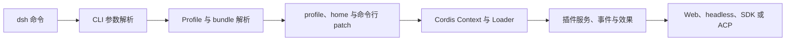
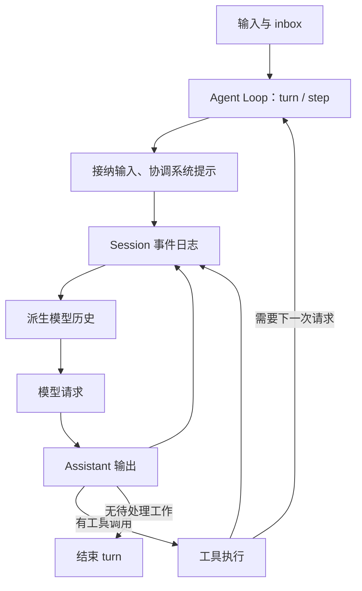
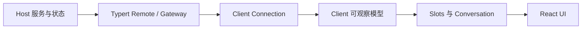

# DeepSeek Harness 项目架构

## 概览

DeepSeek Harness（`dsh`）是基于 Cordis 的插件式 Agent Harness。阅读本文可以了解代码目录、应用如何组合，以及用户输入如何经过模型、工具和界面。模型适配器、工具、Session、Agent Loop、服务端和客户端都由插件组成；应用通过 profile 选择 bundle，再叠加用户 patch 得到运行时插件树。本文提供主要链路的导航，详细行为以链接到的架构文档和包 README 为准。

## 目录

- [目录职责](#目录职责)
- [运行网页](#运行网页)
- [应用组合与启动](#应用组合与启动)
- [Agent 与 Session](#agent-与-session)
- [Web 与 Desktop](#web-与-desktop)
- [源码与构建产物](#源码与构建产物)
- [扩展与开发定位](#扩展与开发定位)
- [延伸阅读](#延伸阅读)
- [维护备注](#维护备注)

-----

## 目录职责

应用入口位于 `apps/`，能力实现位于 `packages/`。下表标出应用、运行时与工程工具的主要位置。

| 目录 | 主要职责 |
|---|---|
| [`apps/cli`](../apps/cli/README.md) | 唯一受支持的 Node 应用启动器 `dsh`，负责解析命令并启动所选 profile。 |
| `apps/web` | Web 浏览器入口；创建 Client 应用并启动浏览器端插件。 |
| [`apps/desktop`](../apps/desktop/README.md) 与 `apps/desktop-host` | Electron 桌面载体及其 Host；复用 Web 应用和 profile 启动流程。 |
| [`packages/`](../packages/README.md) | Cordis 插件、服务定义、服务提供者和消费方，按能力分组。 |
| `python/` | Python SDK 与运行时封装；应用仍由同版本 `dsh` profile 启动。 |
| `native/` | Node 原生 addon 的实现和构建。 |
| `vendor/` | 固定上游版本的 Cordis 依赖副本，按 vendoring 流程维护。 |
| `docs/` | 架构、子系统、开发流程和用户指南等文档。 |
| `website/` | 从 `docs/` 中显式选择并构建的 VitePress 文档站，不是独立的内容真源。 |
| `scripts/` | 构建、代码生成、验证和仓库检查脚本。 |

`packages/` 是按能力组织的 workspace，不是按应用分层的单体模块。常见包组包括 `core`（Session、Agent、工具和 loop）、`llm`（模型适配）、`bundle`（可运行组合）、`api`（Host 远程 API）、`client`（浏览器端 UI 与模型）、`session`（持久化与投影）、`fs`、`shell`、`subprocess`、`sandbox`、`web` 和 `subagent`。完整包组索引见 [`packages/README.md`](../packages/README.md)。

## 运行网页

安装依赖后，在项目根目录运行开发模式：

```sh
pnpm run dev:web
```

命令会先构建应用，再启动 Web，并监听前端源码变动以重建浏览器资源。打开终端输出的访问地址。

如果已经完成构建，可直接复用现有产物启动：

```sh
pnpm dsh web
```

更多启动选项见 [Application commands](../docs/development.md#application-commands)。

## 应用组合与启动

应用入口统一经过 `dsh`。Profile 声明按顺序应用的 bundles；每个 bundle 提供 Cordis 配置行和插件依赖。启动时先应用 bundles，再应用 profile patch、Harness home patch 和命令行 `--patch` overlay。Patch 按行 id 覆盖配置时会替换该行的整个 `config`，不是字段级合并。



`web`、`headless`、`sdk`、`acp` 共享 `dsh-base`，再选择应用 bundle：`web` 加 `web-app`，`headless` 加 one-shot runner，`sdk` 加 JSON-RPC 服务，`acp` 加 ACP 服务。`sdk-minimal` 是独立 bundle，不叠加 `dsh-base`。Desktop 使用保留的 Desktop profile，由 Electron Host 调用共享 profile runner。

Profile 和 patch 的解析、兼容性检查、Loader 生命周期由 [`packages/boot/app-boot`](../packages/boot/app-boot/README.md) 维护；命令入口及 profile 管理由 [`apps/cli`](../apps/cli/README.md) 维护。完整的默认插件组合见 [CLI composition reference](../apps/cli/composition.md)。

## Agent 与 Session

`packages/core/agent` 定义 Agent API 和事件，`packages/core/agent-loop` 提供默认驱动器，`packages/core/session` 管理追加式 Session 事件日志。模型请求从 Session 日志派生历史，因此模型可见输入必须能从已记录事件重建；插件若需改变已有消息历史，应使用 Session message projection。

一个 turn 包含零个或多个 step；首批输入被拒绝或改写为空时，可以在没有 step 的情况下结束。每个 step 包含一次模型请求及其工具调用；接纳的输入、协调后的系统提示和 Assistant 的完整输出流或尝试记录写入 Session。模型请求的历史从日志派生，工具调用和结果也进入日志。没有待处理输入或工具工作后，循环结束 turn；持久化、投影和检索的职责见下方包组索引。



细节参见 [架构文档中的 Turn flow 和 Session log](../docs/architecture.md#turn-flow)、[Core package map](../packages/core/README.md) 和 [Session package map](../packages/session/README.md)。

## Web 与 Desktop

Web 由 Node Host 和浏览器 Client 两侧组成。Host 持有权威业务状态、持久化和访问控制；API controller 通过 Typert 生成的 Remote 方法与流对外提供能力。Client Connection 和 Gateway 承载调用，Client model 保存可观察的浏览器投影。Conversation 组装会话展示模型，Slots 组合界面，UI renderer 绑定 React 并挂载根视图。

浏览器插件清单由 Host 根据启用的 Client 模块生成。Client Web 启动模块和插件后，由 UI renderer 挂载 React 根视图。Desktop 复用相同 Web 页面和 Client 插件；Electron Host 负责启动服务并通过本地载体连接页面。



Host/Client 的类型编译也分开：`tsconfig.host.json` 和 `tsconfig.client.json` 是两个聚合程序，避免 Cordis `Context` 声明合并相互冲突。新增 Client 插件时，遵循 [Web Client architecture](../docs/subsystems/web-client.md)、[Slots](../docs/subsystems/slots.md) 和 [Conversation](../docs/subsystems/conversation.md) 的包间扩展方式。

## 源码与构建产物

仓库使用 pnpm workspace 管理包依赖。根 `tsconfig.json` 是引用 Host/Client 聚合的 solution，不直接组成编译程序；源码分析和测试通过 tsconfig `paths` 解析 workspace 的 `src`。运行时 bundle 则消费编译产物，因此源码检查通过并不代表应用 bundle 已更新。

构建过程按 Host/Client 依赖顺序生成 Typert 元数据和远程声明、编译包、打包运行时与浏览器资源，再检查消费这些产物的程序。`build:artifacts` 负责产物，`build:check` 检查产物的消费者，完整 `build` 包含两部分。构建顺序与本地开发方式以 [TypeScript project layout](../docs/development.md#typescript-project-layout) 为准。

## 扩展与开发定位

新增能力通常由三类角色组成：Service Definition 声明接口，Service Provider 实现能力，Consumer 使用能力。插件通过 Cordis 服务和事件协作，注册应由 `ctx.effect()` 或 `ctx.on()` 管理，以便卸载时清理。Waterfall 事件监听器必须调用 `next()` 才会继续调用链。

| 想修改的行为 | 优先查看 |
|---|---|
| 应用启动或 profile 组合 | [`apps/cli`](../apps/cli/README.md)、[`app-boot`](../packages/boot/app-boot/README.md)、`packages/bundle/` |
| Agent turn、工具调用或模型历史 | [`core` 包组](../packages/core/README.md)、[Agent Loop README](../packages/core/agent-loop/README.md)、[Session subsystem](../docs/subsystems/session.md) |
| 模型 provider | [`llm` 包组](../packages/llm/README.md) 与 [LLM adapter cookbook](../docs/cookbook/adding-an-llm-adapter.md) |
| Web UI、Host API 或会话展示 | [`client` 包组](../packages/client/README.md)、[`api` 包组](../packages/api/README.md)、[Web Client architecture](../docs/subsystems/web-client.md) |
| Session 存储、恢复或查询 | [`session` 包组](../packages/session/README.md)、[`session-query` 包组](../packages/session-query/README.md) |
| 类型、构建或仓库检查 | [Development guide](../docs/development.md) 与仓库根目录 [`AGENTS.md`](../AGENTS.md) |

包公共 API 仍处于 pre-stable 阶段；改动时需要同步更新所有消费者与相应 README/JSDoc。涉及 Session 持久化类型时，先核对 [Session format status](../docs/session-format-status.md) 和 [persistence type review](../docs/cookbook/reviewing-persistence-type-changes.md)。

## 延伸阅读

以下资料分别负责框架基础、运行架构、开发流程和详细子系统参考。

- [架构文档](../docs/architecture.md)：profile、核心包、turn flow、Session log 和扩展点的权威说明。
- [Cordis primer](../docs/cordis-primer.md)：理解插件、服务、事件和效果的基础概念。
- [Development guide](../docs/development.md)：本仓库的构建、Host/Client 编译面和本地验证流程。
- [Subsystem index](../docs/subsystems/README.md)：按 Agent、Session、Web Client 等领域深入接口和语义。
- [apps/web 技术架构](web-architecture.md)：从 Web 启动、插件交付和 Remote 追踪到会话恢复、UI 装配与排查入口。

-----

## 维护备注

<details>
<summary>非权威的临时维护记录</summary>

无。

</details>
