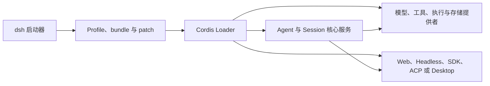
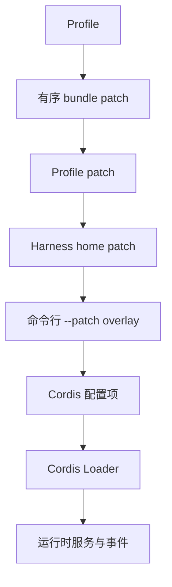
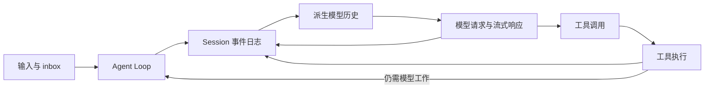
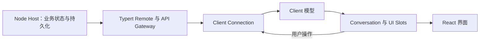

# DeepSeek Harness 技术架构

## 概述

本文从运行时角度说明 DeepSeek Harness 如何由 `dsh` 启动器组装插件、驱动 Agent 请求，并通过 Session 日志和 Host/Client 分层连接应用功能。文中也列出主要语言、框架和构建工具，便于快速了解技术栈。具体运行约定以[架构主文档](../docs/architecture.zh.md)及各包 README 为准；项目目录和入口见[项目架构导览](project-architecture.md)。

## 目录

- [运行时组成](#运行时组成)
- [技术栈](#技术栈)
- [直接依赖包清单](#直接依赖包清单)
- [启动与插件组合](#启动与插件组合)
- [Agent 执行与 Session 数据流](#agent-执行与-session-数据流)
- [Host 与 Client 分层](#host-与-client-分层)
- [按职责定位代码](#按职责定位代码)
- [延伸阅读](#延伸阅读)
- [维护备注](#维护备注)

-----

## 运行时组成

应用运行时是一棵由 Cordis Loader 装载的插件树。`dsh` 启动器选择 profile，profile 组合 bundle 与 patch；Loader 随后挂载配置中的插件，由它们提供 Agent、模型、工具、持久化和应用界面等能力。

主要代码按职责分组；包组是能力目录，不代表固定的应用分层。

| 职责 | 主要位置 | 作用 |
|---|---|---|
| 启动与组合 | [`apps/cli`](../apps/cli/README.zh.md)、[`app-boot`](../packages/boot/app-boot/README.zh.md) | 解析启动目标，组装 profile、bundle 和配置 patch，并启动 Loader。 |
| Agent 核心 | [`packages/core`](../packages/core/README.zh.md) | 提供 Agent、Agent Loop、Session、提示词和工具执行协调。 |
| 能力提供者 | `packages/llm/`、`packages/fs/`、`packages/shell/`、`packages/subprocess/`、`packages/sandbox/` | 为模型请求、文件访问和进程执行提供可替换实现。 |
| 应用与远程通信 | `apps/web/`、`apps/desktop/`、`packages/api/`、`packages/client/` | 提供 Web 与 Desktop 入口、Host API 和浏览器端状态及界面。 |
| Session 持久化 | [`packages/session`](../packages/session/README.zh.md) | 提供 Session 格式、持久化、查询和投影相关能力。 |

## 技术栈

仓库以 TypeScript 和 Node.js 为主要实现环境，并按 workspace 为 Web、Desktop、Python SDK 和原生组件配置各自的依赖。下表列出主要技术；版本范围以对应清单为准，不代表所有 workspace 共用同一个版本。

| 层次 | 技术 | 用途与来源 |
|---|---|---|
| 语言与运行时 | TypeScript `^6.0.3`、ESM、Node.js `>=24.9.0`、pnpm `11.28.5` | 根 workspace 与主要应用的开发和运行环境；见[根 package.json](../package.json)。 |
| 插件与远程 API | Cordis、Typert | Cordis 组合运行时插件；Typert 从类型声明生成 Host 到 Client 的 Remote API；见 [Typert 包组](../packages/typert/README.zh.md)。 |
| Web | React / React DOM `^18.2.0`、Vite `^6.4.3` | 构建浏览器应用；依赖见 [`apps/web/package.json`](../apps/web/package.json)。 |
| Desktop | Electron `^44.7.0` | 提供桌面 Host，并复用 Web Client；依赖见 [`apps/desktop/package.json`](../apps/desktop/package.json)。 |
| 模型接入 | DeepSeek 适配器、`@earendil-works/pi-ai` | 通过 LLM 插件接入 DeepSeek 和 pi-ai 支持的模型提供方；见 [pi-ai 适配器](../packages/llm/llm-pi-ai/README.zh.md)。 |
| Python SDK | Python `>=3.10`、Pydantic `>=2.12,<3` | Python 客户端通过 stdio 上的 JSON-RPC 驱动随 SDK 分发的 `dsh` 运行时；见 [`python/sdk/pyproject.toml`](../python/sdk/pyproject.toml) 和 [Python SDK 说明](../python/README.zh.md)。 |
| 原生组件 | C11、Node-API v8 | 提供 Linux Landlock 启动器和 POSIX `flock` 绑定；通过平台包分发；见 [Node Addon System](../native/system/README.zh.md)。 |
| 构建与检查 | TypeScript compiler、tsdown、Vite、Vitest、Oxlint | 编译 Host/Client、打包运行时与浏览器资源，并运行测试和静态检查；工具版本由根及各应用的 `package.json` 管理。 |

文档站点另使用 VitePress 和 Vue；它从仓库文档投影构建，不属于 Agent 运行时；依赖见 [`website/package.json`](../website/package.json)。

## 直接依赖包清单

以下按包名去重，列出 pnpm 工作区声明的 593 个 npm 直接依赖和 Python SDK 声明的 5 个直接依赖，并简述各包用途。npm 传递依赖和实际解析版本见 [pnpm-lock.yaml](../pnpm-lock.yaml)；Python 依赖声明见 [SDK 配置](../python/sdk/pyproject.toml)和[运行时包配置](../python/sdk-runtime/pyproject.toml)。

查看全部 598 个直接依赖包

| 依赖包 | 用途说明 |
|---|---|
| `@agentclientprotocol/sdk` | Agent Client Protocol 客户端 SDK，用于编辑器与编码 Agent 通信。 |
| `@anthropic-ai/claude-agent-sdk` | 通过 Claude Code 能力构建和驱动 Agent。 |
| `@anthropic-ai/sdk` | Anthropic API 的 TypeScript SDK。 |
| `@babel/code-frame` | 在错误信息中生成带源码位置的代码片段。 |
| `@botiverse/oar` | 控制和观察不同 Agent Runtime 的统一接口。 |
| `@braintree/sanitize-url` | 清理和校验 URL。 |
| `@browserbasehq/stagehand` | 构建浏览器 Agent 的 SDK。 |
| `@deepseek-ai/cordis` | 提供插件上下文、服务、事件和插件生命周期管理。 |
| `@deepseek-ai/cordis-plugin-group` | 把多个 Cordis 插件组织为可嵌套的插件组。 |
| `@deepseek-ai/cordis-plugin-include` | 读取和保存 YAML、JSON 描述的 Cordis 插件配置树。 |
| `@deepseek-ai/cordis-plugin-loader` | 根据配置加载 Cordis 插件并维护运行中的插件树。 |
| `@deepseek-ai/cordis-plugin-logger-console` | 将 Cordis 日志输出到终端或浏览器控制台。 |
| `@deepseek-ai/cordis-plugin-timer` | 提供随插件卸载自动清理的定时器、节流和防抖功能。 |
| `@deepseek-ai/cosmokit` | 为 Cordis 和 Schemastery 提供引用、快照、比较等通用工具。 |
| `@deepseek-ai/dsh` | 提供 dsh 命令行入口，用于启动 profile、管理插件和检查配置。 |
| `@deepseek-ai/dsh-acp` | 提供仅用于自动化的 ACP 服务，通过 JSON-RPC 标准输入输出驱动 Agent。 |
| `@deepseek-ai/dsh-acp-app` | 组合 ACP profile，提供自动化 JSON-RPC 通信及进程生命周期管理。 |
| `@deepseek-ai/dsh-action-cards` | 在回答下提供操作卡片，统一提案工具、卡片状态、用户操作和状态通知。 |
| `@deepseek-ai/dsh-agent` | 定义 Agent 接口、注册表、发起者作用域及事件。 |
| `@deepseek-ai/dsh-agent-default-model` | 为各 Agent 入口统一选择默认模型。 |
| `@deepseek-ai/dsh-agent-instructions` | 加载工作区内 AGENTS.md 和 CLAUDE.md 指令文件。 |
| `@deepseek-ai/dsh-agent-loop` | 提供 Agent 主循环的具体实现。 |
| `@deepseek-ai/dsh-agent-loop-testkit` | 为测试挂载前置服务，提供生产 AgentLoop 驱动器和 Inbox 替身。 |
| `@deepseek-ai/dsh-agent-preset` | 通过 Cordis YAML 声明 Agent 的能力组合。 |
| `@deepseek-ai/dsh-agent-preset-registry` | 注册声明式 Agent 预设，并通过 profile 编辑预设。 |
| `@deepseek-ai/dsh-agent-team` | 为子 Agent 树共享任务依赖图，并等待任务变化。 |
| `@deepseek-ai/dsh-agent-tool-presentation` | 提供已弃用的工具呈现方式选择器，由原生或 PTC 工具执行器替代。 |
| `@deepseek-ai/dsh-anonymous-user-id` | 提供匿名用户标识，用于关联遥测和反馈。 |
| `@deepseek-ai/dsh-api-gateway` | 分派 Host 端 Typert Remote 请求，并提供客户端 API 端点。 |
| `@deepseek-ai/dsh-api-job-controller` | 提供后台任务远程观察流，并管理客户端任务输出的引用计数。 |
| `@deepseek-ai/dsh-api-remote-access` | 按方法控制非所有者连接的远程访问权限，并生成各连接的权限快照。 |
| `@deepseek-ai/dsh-api-remotes` | 为应用选用的 Host 能力组装远程 BFF 接口。 |
| `@deepseek-ai/dsh-api-session-controller` | 提供 Session 远程命令、非实时读取和实时控制传输。 |
| `@deepseek-ai/dsh-api-settings-controller` | 通过远程接口管理各设置域的配置。 |
| `@deepseek-ai/dsh-api-terminal-controller` | 提供会话所属交互终端的 Shell 发现、屏幕恢复和类型化远程控制。 |
| `@deepseek-ai/dsh-api-workspace-controller` | 提供工作区远程命令和支持重连的状态传输。 |
| `@deepseek-ai/dsh-api-workspace-files` | 提供工作区文件限量读取、目录列举和实时元数据，并接入客户端资源系统。 |
| `@deepseek-ai/dsh-app-boot` | 统一加载 .env、检查 Loader、解析快照感知配置并执行应用启动流程。 |
| `@deepseek-ai/dsh-atomic-write` | 通过独占创建临时文件并重命名，按调用方权限原子替换文件。 |
| `@deepseek-ai/dsh-attachment` | 定义持久化、不可变附件存储接口。 |
| `@deepseek-ai/dsh-attachment-local` | 在 DSH_HOME 中提供私有、按内容寻址的附件存储。 |
| `@deepseek-ai/dsh-authorization` | 定义插件与用户交互以取得凭据的授权流程。 |
| `@deepseek-ai/dsh-base` | 提供各 profile 共用的核心插件组合，作为基础配置的首层补丁。 |
| `@deepseek-ai/dsh-bash-local` | 使用本地子进程执行 Bash 命令。 |
| `@deepseek-ai/dsh-bash-sandbox` | 通过沙箱执行 Bash 命令，并报告拒绝或约束执行结果。 |
| `@deepseek-ai/dsh-brand` | 提供带品牌标记的基础类型，用于静态区分不同类别的标识和值。 |
| `@deepseek-ai/dsh-browser-use` | 注册具有独占名称的浏览器操作提供者。 |
| `@deepseek-ai/dsh-chunked-list` | 提供仅追加的分块列表，限制复制开销并校验 JSON 检查点。 |
| `@deepseek-ai/dsh-client-connection` | 提供经过身份认证的 RPC 传输，并管理连接代次的生命周期。 |
| `@deepseek-ai/dsh-client-file-upload` | 提供 Agent 作用域的浏览器文件上传、流式接收和分阶段回执。 |
| `@deepseek-ai/dsh-client-hmr` | 同步 Web 客户端模块图，并在构建更新后传递重载通知。 |
| `@deepseek-ai/dsh-client-locale` | 管理语言偏好、可扩展语言目录、浏览器回退选择和类型化词典。 |
| `@deepseek-ai/dsh-client-modules` | 在 Host 组装客户端入口模块图，并为浏览器 Cordis Loader 提供延迟加载模块表。 |
| `@deepseek-ai/dsh-client-product-analytics` | 采集 Desktop 产品事件，并经认证向 Host 上报。 |
| `@deepseek-ai/dsh-client-resources` | 将 URL 交由按协议注册的资源提供者解析为实时值，并提供 useResource 访问。 |
| `@deepseek-ai/dsh-client-script-realm` | 提供直接引用式脚本环境及 Cordis 管理的提供者注册。 |
| `@deepseek-ai/dsh-client-shortcuts` | 注册应用键盘命令，并按物理按键路由输入。 |
| `@deepseek-ai/dsh-client-store` | 定义可观察状态和快照存储接口，提供共享的 Zustand 与 Immer 引擎。 |
| `@deepseek-ai/dsh-client-test-runtime` | 提供 jsdom 插槽测试台和运行完整生产客户端的 Remote 模拟测试环境。 |
| `@deepseek-ai/dsh-client-ui-account-notifications` | 展示账号通知，并刷新其本地化内容。 |
| `@deepseek-ai/dsh-client-ui-action-cards` | 展示回答下的操作卡片，提供卡片容器、类型内容和紧凑工具行。 |
| `@deepseek-ai/dsh-client-ui-agent-preset` | 提供后续会话默认预设、当前会话预设及能力组合编辑界面。 |
| `@deepseek-ai/dsh-client-ui-agent-team` | 展示子 Agent 树共用的任务看板。 |
| `@deepseek-ai/dsh-client-ui-approval` | 在审批请求期间接管会话输入区，承载审批交互。 |
| `@deepseek-ai/dsh-client-ui-attachment` | 在会话输入、消息图片及轨迹图片插槽中动态展示附件。 |
| `@deepseek-ai/dsh-client-ui-brand-official` | 提供官方品牌图稿，以及点击触发的首页背景。 |
| `@deepseek-ai/dsh-client-ui-chat` | 定义聊天会话目标、节点类型、渲染器及详情界面。 |
| `@deepseek-ai/dsh-client-ui-commands` | 提供斜杠命令候选、命令目录缓存及多类命令交互界面。 |
| `@deepseek-ai/dsh-client-ui-context-menu` | 提供类型化、可由插件扩展的上下文菜单，并保留菜单操作目标。 |
| `@deepseek-ai/dsh-client-ui-conversation` | 组装通用会话界面、输入区、队列和视图导航。 |
| `@deepseek-ai/dsh-client-ui-cordis` | 展示 cordis_define 动态插件定义卡片，并提供运行与停止开关。 |
| `@deepseek-ai/dsh-client-ui-creation-recommendations` | 展示个性化页面卡片的位置选择、创建进度、撤销和恢复操作。 |
| `@deepseek-ai/dsh-client-ui-deliverables` | 展示变更文件比较、交付卡片及最终回答中可点击的文件引用。 |
| `@deepseek-ai/dsh-client-ui-directory-picker-browse` | 通过 Host 目录列举和创建能力，提供应用内工作区目录浏览界面。 |
| `@deepseek-ai/dsh-client-ui-directory-picker-native` | 驱动本机 Desktop 或 Host 操作系统的原生工作区目录选择器。 |
| `@deepseek-ai/dsh-client-ui-dockkit` | 提供可逆操作的分栏布局树，以及渲染和操作布局的 React 组件。 |
| `@deepseek-ai/dsh-client-ui-entry-customization` | 自定义左右侧栏与会话视图中的插件入口，并快速创建插件。 |
| `@deepseek-ai/dsh-client-ui-file-actions` | 为 Web 和 Desktop 提供原文件保存及图片复制到剪贴板操作。 |
| `@deepseek-ai/dsh-client-ui-file-drag` | 管理应用内文件拖放传输，并提供本地化失败反馈。 |
| `@deepseek-ai/dsh-client-ui-goal` | 读取会话目标投影，在输入区上方展示目标栏。 |
| `@deepseek-ai/dsh-client-ui-input-trigger` | 检测输入中的 / 和 @，展示候选菜单并路由选择结果。 |
| `@deepseek-ai/dsh-client-ui-jobs` | 在会话标题栏展示后台任务，并按需流式显示任务记录。 |
| `@deepseek-ai/dsh-client-ui-layout` | 提供可拖拽调整的三栏应用框架，以及导航和面板状态服务。 |
| `@deepseek-ai/dsh-client-ui-message-feedback` | 提供消息赞踩操作、反馈对话框和 /feedback 界面，并提交到 Host。 |
| `@deepseek-ai/dsh-client-ui-model-selection` | 基于共享模型目录和会话状态，提供模型选择操作。 |
| `@deepseek-ai/dsh-client-ui-open-in-app` | 为目录和预览文件提供应用子菜单及原生应用打开控件。 |
| `@deepseek-ai/dsh-client-ui-permission-presets` | 提供新会话默认权限设置，以及当前会话的 /permission 选择界面。 |
| `@deepseek-ai/dsh-client-ui-plan` | 提供计划模式控件、持久化计划卡片和侧栏 Markdown 预览。 |
| `@deepseek-ai/dsh-client-ui-plugin-manager` | 提供插件面板，用于安装、启停、重试和组合已安装插件包。 |
| `@deepseek-ai/dsh-client-ui-plugin-market` | 在插件发现页浏览已配置市场索引，并安装其中的插件组合。 |
| `@deepseek-ai/dsh-client-ui-plugin-recommendations` | 展示官方插件推荐卡片的说明，并提供启用操作。 |
| `@deepseek-ai/dsh-client-ui-primitives` | 提供纯 React 基础控件、图标、Markdown 展示和 JSON 检查组件。 |
| `@deepseek-ai/dsh-client-ui-reference` | 统一提供 Web 端 @file 和 @session 引用候选。 |
| `@deepseek-ai/dsh-client-ui-renderer` | 将 React 组件绑定到 UI 插槽，并组装浏览器应用根组件。 |
| `@deepseek-ai/dsh-client-ui-schedule` | 提供 Host 定时任务管理页面和会话提醒目录。 |
| `@deepseek-ai/dsh-client-ui-secret-mask` | 在 Web 显示已发送用户文本时，遮蔽识别出的凭据。 |
| `@deepseek-ai/dsh-client-ui-session` | 将 Session Controller 接入 React，并提供会话作用域插槽。 |
| `@deepseek-ai/dsh-client-ui-session-status` | 根据 Host 阅读记录展示会话运行状态、待处理交互及跨客户端未读提醒。 |
| `@deepseek-ai/dsh-client-ui-settings` | 提供共享设置表单，并定义设置插槽的类型接口。 |
| `@deepseek-ai/dsh-client-ui-settings-account` | 提供 DeepSeek 登录管理及 Platform 账单页面入口。 |
| `@deepseek-ai/dsh-client-ui-settings-agent-loop` | 提供 Agent 主循环并行工具调用数量上限的设置页面。 |
| `@deepseek-ai/dsh-client-ui-settings-general` | 提供通用设置、应用引导、相关文案词典和版本化欢迎通知。 |
| `@deepseek-ai/dsh-client-ui-settings-models` | 通过设置及凭据服务提供模型设置和产品引导对话框。 |
| `@deepseek-ai/dsh-client-ui-settings-plugin-inventory` | 在 Web 插件设置中展示只读 Cordis Loader 插件清单。 |
| `@deepseek-ai/dsh-client-ui-settings-plugins` | 提供内置插件设置入口，以及各功能设置页注册的标签栏。 |
| `@deepseek-ai/dsh-client-ui-settings-session-log` | 提供随 DeepSeek API 请求上传 Session 日志的通用设置控件。 |
| `@deepseek-ai/dsh-client-ui-settings-shell` | 提供命令超时和各输出流大小上限的 Shell 设置页面。 |
| `@deepseek-ai/dsh-client-ui-settings-subagent` | 提供子 Agent 递归深度、并行容量和可选模型设置页面。 |
| `@deepseek-ai/dsh-client-ui-settings-web-search` | 提供搜索与抓取服务选择、结果数量、计费和旧版搜索设置页面。 |
| `@deepseek-ai/dsh-client-ui-shortcuts` | 展示快捷键参考，并支持快捷键录制和本地偏好编辑。 |
| `@deepseek-ai/dsh-client-ui-sidebar` | 展示会话多层树、搜索、分组和状态标记。 |
| `@deepseek-ai/dsh-client-ui-sidebar-browser` | 在右侧栏提供受沙箱约束的 Web 浏览器标签页。 |
| `@deepseek-ai/dsh-client-ui-sidebar-documentpreview` | 在侧栏预览 Office、表格、Markdown、代码、图片、PDF、HTML 和文本。 |
| `@deepseek-ai/dsh-client-ui-sidebar-files` | 提供工作区文件页面、延迟加载目录树及停靠或浮动文件预览。 |
| `@deepseek-ai/dsh-client-ui-sidebar-right` | 管理右侧栏停靠区的会话状态、面板、展开控件和导航。 |
| `@deepseek-ai/dsh-client-ui-sidebar-terminal` | 在右侧栏提供交互式 Shell 标签页。 |
| `@deepseek-ai/dsh-client-ui-skill` | 展示 Web 技能引用及专用技能工具行。 |
| `@deepseek-ai/dsh-client-ui-slots` | 提供类型化 UI 插槽、可复用组件工厂、派生属性和渲染器注册。 |
| `@deepseek-ai/dsh-client-ui-subagent` | 提供子 Agent 会话目录、继续对话路由界面和 @ 引用候选。 |
| `@deepseek-ai/dsh-client-ui-theme` | 管理浅色、深色及系统主题，提供颜色令牌、图标替换和外观设置。 |
| `@deepseek-ai/dsh-client-ui-tool` | 渲染工具调用树，并按工具名称选择呈现插槽。 |
| `@deepseek-ai/dsh-client-ui-trajectory` | 展示执行轨迹事件、耗时概览，并实时查看工具结果。 |
| `@deepseek-ai/dsh-client-ui-user-questions` | 为 ask_user_question 接管输入区，并展示计划审核界面。 |
| `@deepseek-ai/dsh-client-ui-workflow-run` | 展示持久化工作流运行会话节点，并支持展开嵌套成员。 |
| `@deepseek-ai/dsh-client-ui-workspace` | 在侧栏和空状态插槽中提供工作区选择器。 |
| `@deepseek-ai/dsh-client-web` | 启动 Web 客户端模块表和 Cordis Loader，显示启动页并交接 UI 渲染器。 |
| `@deepseek-ai/dsh-cmdline` | 将启动器命令行参数以不可变形式传给需要参数的应用插件。 |
| `@deepseek-ai/dsh-command-compact` | 提供由用户显式触发会话压缩的斜杠命令。 |
| `@deepseek-ai/dsh-command-feedback` | 提供会话反馈记录事件、远程接口和用户斜杠命令。 |
| `@deepseek-ai/dsh-command-goal` | 提供在当前会话持久保存目标的用户斜杠命令。 |
| `@deepseek-ai/dsh-commands` | 为用户界面注册插件提供的人工操作命令。 |
| `@deepseek-ai/dsh-compaction` | 定义上下文压缩服务接口。 |
| `@deepseek-ai/dsh-compaction-basic` | 按 token 用量触发上下文压缩，并通过大模型生成摘要。 |
| `@deepseek-ai/dsh-compaction-image-offload` | 将超出请求预算的图片持久化并替换为占位内容，然后重试请求。 |
| `@deepseek-ai/dsh-compaction-tool-result-pruner` | 按策略裁剪过长的工具结果，并保持日志可重放，无需额外模型调用。 |
| `@deepseek-ai/dsh-computer-use` | 注册具有独占名称的计算机操作提供者。 |
| `@deepseek-ai/dsh-config-editor` | 通过 profile 补丁和 Loader 协调持久保存插件配置。 |
| `@deepseek-ai/dsh-cordis-client-runner` | 运行动态插件的浏览器部分，提供事件订阅、闭包求值、保护接口和加载入口。 |
| `@deepseek-ai/dsh-cordis-host-runner` | 注册模型动态挂载的双端插件，管理 Host 沙箱生命周期及调用处理器。 |
| `@deepseek-ai/dsh-creation-recommendations` | 根据明确的会话需求创建可持久保存、可移除的界面插件。 |
| `@deepseek-ai/dsh-credentials` | 定义凭据服务，使设置保存密钥引用、提供者管理实际密钥值。 |
| `@deepseek-ai/dsh-credentials-local` | 从 DSH_HOME 的 .env 及当前进程环境提供凭据。 |
| `@deepseek-ai/dsh-cua` | 提供共享的计算机操作应用对象、授权及记录入日志的工具执行。 |
| `@deepseek-ai/dsh-cua-bundle` | 组合 macOS 和 Windows 的可选计算机操作能力。 |
| `@deepseek-ai/dsh-cua-macos` | 通过 macOS 原生能力提供共享应用和窗口对象的计算机操作。 |
| `@deepseek-ai/dsh-cua-mcp` | 将计算机操作封装成 MCP 标准输入输出服务，向外部 Agent 提供 cua_run_code。 |
| `@deepseek-ai/dsh-cua-windows` | 通过 Windows C# 实现共享应用和窗口对象的计算机操作。 |
| `@deepseek-ai/dsh-deepseek-account` | 提供 DeepSeek 登录、账号凭据和通知管理。 |
| `@deepseek-ai/dsh-deepseek-chat-import` | 将 DeepSeek 聊天导出文件导入指定工作区，保存为 Session。 |
| `@deepseek-ai/dsh-deepseek-llm-api-extensions` | 为官方 DeepSeek 大模型适配器注册附加请求字段。 |
| `@deepseek-ai/dsh-deliverable-file-references` | 为各 Host 提供统一的文件链接和交付物模型指引。 |
| `@deepseek-ai/dsh-deque` | 提供无依赖的循环双端队列，支持均摊常数时间的两端操作并限制空闲存储。 |
| `@deepseek-ai/dsh-desktop-publisher` | 发布 Desktop 版本元数据、灰度发布配置和网站内容。 |
| `@deepseek-ai/dsh-error` | 提供带稳定机器可识别错误码、无外部依赖的 HarnessError 基类。 |
| `@deepseek-ai/dsh-experimental-api-speech-to-text` | 为浏览器客户端提供经过身份认证的实验性语音转写接口。 |
| `@deepseek-ai/dsh-experimental-auto-review` | 在 Auto 权限预设下，使用大模型逐次审核工具调用授权。 |
| `@deepseek-ai/dsh-experimental-badge-skill-bundle` | 提供技能，让 Agent为文档、PR 等产物添加 powered by dsh 徽章。 |
| `@deepseek-ai/dsh-experimental-browser-use-chrome-devtools-mcp` | 通过 chrome-devtools-mcp 为每个 Session 提供实验性 Chromium 操作工具。 |
| `@deepseek-ai/dsh-experimental-browser-use-playwright-mcp` | 通过 @playwright/mcp 为每个 Session 提供实验性 Chromium 操作工具。 |
| `@deepseek-ai/dsh-experimental-browser-use-runtime` | 管理会话所属浏览器资源的生命周期，并为实验性提供者集成 MCP。 |
| `@deepseek-ai/dsh-experimental-browser-use-stagehand-native` | 通过 Stagehand 和单独配置的模型提供实验性浏览器操作工具。 |
| `@deepseek-ai/dsh-experimental-claude-code-mods` | 加载 Claude Code 钩子模块，并在 Harness 扩展点运行其钩子链。 |
| `@deepseek-ai/dsh-experimental-client-ui-cot-translation` | 在保留 Session 原文的同时，为展开的推理内容提供可选机器翻译。 |
| `@deepseek-ai/dsh-experimental-client-ui-forge` | 在侧栏展示会话变更请求，并为新会话提供 worktree 选项及远程接口。 |
| `@deepseek-ai/dsh-experimental-client-ui-stats` | 在会话视图展示逐轮、逐步骤的上下文、耗时、缓存和工具成本统计。 |
| `@deepseek-ai/dsh-experimental-client-ui-voice-input` | 录制语音，并将可编辑的识别文本插入会话草稿。 |
| `@deepseek-ai/dsh-experimental-computer-use-cua-driver-mcp` | 通过已安装的 Cua Driver MCP 程序提供实验性计算机操作。 |
| `@deepseek-ai/dsh-experimental-computer-use-cua-driver-native` | 嵌入 Cua Driver 原生 npm SDK，提供实验性计算机操作。 |
| `@deepseek-ai/dsh-experimental-cot-translation-bundle` | 组合展开推理内容的实验性机器翻译能力。 |
| `@deepseek-ai/dsh-experimental-forge` | 提供与平台无关的变更请求注册表，并统一轮询状态。 |
| `@deepseek-ai/dsh-experimental-forge-bundle` | 为 Git 仓库中的会话组合变更请求面板和 worktree 选项。 |
| `@deepseek-ai/dsh-experimental-forge-github` | 通过 Host 上的 GitHub CLI 读取 GitHub 变更请求，接入 Forge 注册表。 |
| `@deepseek-ai/dsh-experimental-forge-session` | 将变更请求关联到创建、推送或跟踪该请求的 Session。 |
| `@deepseek-ai/dsh-experimental-inspector` | 提供跨运行环境的 CDP 中心，用于 Host 调试和客户端运行时检查。 |
| `@deepseek-ai/dsh-experimental-inspector-profile` | 组合用于查看 Session 原始日志和 Chat 节点的可选 Web 检查工具。 |
| `@deepseek-ai/dsh-experimental-liveshare` | 通过独立中继共享会话，支持查看或受限写入，并独立控制分叉及附件上传。 |
| `@deepseek-ai/dsh-experimental-liveshare-protocol` | 定义 LiveShare 所有者端和中继共用的线协议帧及身份约定。 |
| `@deepseek-ai/dsh-experimental-plugin-market-bundle` | 组合自定义插件索引发现页，用于浏览索引并安装插件组合。 |
| `@deepseek-ai/dsh-experimental-ralph-bundle` | 按用户明确要求，使用新的 Agent 反复执行工作。 |
| `@deepseek-ai/dsh-experimental-session-inspector` | 提供虚拟化 Session 日志查看器及实时 Chat 分组、节点检查器。 |
| `@deepseek-ai/dsh-experimental-session-search` | 为 Agent提供搜索和读取当前工作区历史会话的工具。 |
| `@deepseek-ai/dsh-experimental-session-titles-bundle` | 收到新的用户提示时刷新会话标题。 |
| `@deepseek-ai/dsh-experimental-speech-to-text` | 定义可独立选择提供者的实验性语音识别能力。 |
| `@deepseek-ai/dsh-experimental-speech-to-text-sensevoice` | 通过受管理的 sherpa-onnx 进程运行本地 SenseVoice ONNX 语音转写。 |
| `@deepseek-ai/dsh-experimental-subagent-oar` | 通过 OAR 运行时执行一次性子 Agent 任务。 |
| `@deepseek-ai/dsh-experimental-terminal-bundle` | 让 Agent运行长期命令，并在侧栏终端中供用户查看。 |
| `@deepseek-ai/dsh-experimental-tool-subagent-oar` | 提供工具，将独立任务委派给已配置的外部子 Agent 提供者。 |
| `@deepseek-ai/dsh-experimental-tool-worktree` | 提供模型工具，创建并进入新的 Git worktree。 |
| `@deepseek-ai/dsh-experimental-translator` | 提供机器翻译，并复用 Session 中已有的翻译结果。 |
| `@deepseek-ai/dsh-experimental-voice-input-bundle` | 组合本地 SenseVoice 语音输入，并在首次使用时下载运行时。 |
| `@deepseek-ai/dsh-experimental-webworker-packer` | 在构建时打包浏览器运行时的基础虚拟文件系统镜像和有序数据覆盖归档。 |
| `@deepseek-ai/dsh-experimental-webworker-runtime` | 在浏览器 Web Worker 中运行 Harness，提供内存文件系统、模块加载和 Node 兼容层。 |
| `@deepseek-ai/dsh-experimental-worktree` | 创建命名 Git worktree，并切换调用 Session 的工作目录。 |
| `@deepseek-ai/dsh-file-reference` | 定义文件引用发现接口和共用的 @file 语法。 |
| `@deepseek-ai/dsh-file-reference-local` | 通过有界模糊索引提供本地文件系统的文件引用发现。 |
| `@deepseek-ai/dsh-fs` | 定义文件系统类型、文本读写、可选版本保护原子修改及策略事件接口。 |
| `@deepseek-ai/dsh-fs-local` | 使用本地文件系统实现文件读写服务。 |
| `@deepseek-ai/dsh-fs-observation-policy` | 通过文件系统策略事件实现已读状态跟踪、编辑前读取和版本保护修改。 |
| `@deepseek-ai/dsh-fs-patch` | 解析 Codex 风格补丁并更新 LF 文本，提供结构化匹配失败信息。 |
| `@deepseek-ai/dsh-fs-sandbox` | 按调用的沙箱模式约束文件修改，支持只读或工作区及临时目录内写入。 |
| `@deepseek-ai/dsh-fs-ssh` | 通过共享 POSIX SSH 辅助程序提供远程文件系统服务。 |
| `@deepseek-ai/dsh-goal` | 以会话事件记录持久化同一 Session 的目标状态，并管理目标生命周期。 |
| `@deepseek-ai/dsh-goal-round-driver` | 驱动同一会话中的目标执行轮次，并隔离并发竞态。 |
| `@deepseek-ai/dsh-harness-dev-context` | 向模型提供 Harness 仓库位置和 Web GUI 地址，保持系统提示不变。 |
| `@deepseek-ai/dsh-headless` | 基于 dsh-base 直接运行一次性 Agent/Session 任务，无需 Host 或浏览器。 |
| `@deepseek-ai/dsh-hmr` | 协调模块代码和 profile 配置的热重载。 |
| `@deepseek-ai/dsh-home-paths` | 统一计算 Harness home 及其资源的文件系统路径。 |
| `@deepseek-ai/dsh-hook-protocol` | 提供 Claude Code/Codex hook 的匹配、输入输出编解码、结果合并和会话事件协议。 |
| `@deepseek-ai/dsh-hooks-claude-code` | 把 Claude Code 的 hooks.json 或 settings hook 配置接入 Harness 拦截事件。 |
| `@deepseek-ai/dsh-hooks-codex` | 把 Codex 的 hooks.json 配置接入 Harness 拦截事件。 |
| `@deepseek-ai/dsh-host-authentication-desktop` | 为 Desktop 的私有通信通道提供身份验证。 |
| `@deepseek-ai/dsh-host-authentication-token` | 提供令牌身份验证及令牌到 HTTP cookie 的交换。 |
| `@deepseek-ai/dsh-host-directory-picker` | 定义 Web Host 的工作区目录选择接口。 |
| `@deepseek-ai/dsh-host-directory-picker-auto` | 按启动时的 Host 环境选择并挂载原生或应用内目录选择器。 |
| `@deepseek-ai/dsh-host-directory-picker-browse` | 通过应用内浏览 Host 文件系统来列出、创建和选择目录。 |
| `@deepseek-ai/dsh-host-directory-picker-native` | 调用操作系统原生对话框选择工作区目录。 |
| `@deepseek-ai/dsh-host-frontend-static` | 为 Web 应用提供入口页和静态构建资源，并拒绝路径穿越。 |
| `@deepseek-ai/dsh-host-open-in-app` | 提供本机应用目录、图标和通过本机应用打开文件的 Host 路由。 |
| `@deepseek-ai/dsh-host-plugin-inventory` | 通过只读 Remote API 暴露当前 Cordis Loader 插件状态。 |
| `@deepseek-ai/dsh-host-product-telemetry-otel` | 通过 OpenTelemetry HTTP 日志导出显式产品使用事件。 |
| `@deepseek-ai/dsh-host-webserver` | 注册 HTTP 和协议升级路由、按连接转换入口页并提供静态资源回退。 |
| `@deepseek-ai/dsh-http-proxy` | 从启动环境解析出站 HTTP 代理，并安装为 undici 的进程级 dispatcher。 |
| `@deepseek-ai/dsh-jobs` | 定义长时间工具工作的后台任务注册、轮询、取消和完成通知服务。 |
| `@deepseek-ai/dsh-jobs-local` | 在当前进程内实现后台任务注册表。 |
| `@deepseek-ai/dsh-launch-environment` | 保存不可变的启动环境及每个值所属的配置层。 |
| `@deepseek-ai/dsh-lazy-require` | 相对调用方延迟加载兼容 CommonJS 的 Host 依赖，并缓存成功结果。 |
| `@deepseek-ai/dsh-llm` | 定义不绑定模型提供方的 LLM 请求、响应与流式服务接口。 |
| `@deepseek-ai/dsh-llm-deepseek` | 将 Harness 模型请求适配为 DeepSeek Messages API 调用。 |
| `@deepseek-ai/dsh-llm-deepseek-account` | 通过 DeepSeek 账户完成模型提供方认证和发现。 |
| `@deepseek-ai/dsh-llm-deepseek-api-key` | 通过 API key 完成 DeepSeek 模型提供方认证和发现。 |
| `@deepseek-ai/dsh-llm-mock-server` | 为模型恢复测试提供可编排的 Messages HTTP/SSE 故障服务器。 |
| `@deepseek-ai/dsh-llm-pi-ai` | 通过 pi-ai 将模型请求路由到多提供方、兼容网关或自托管服务器。 |
| `@deepseek-ai/dsh-llm-replay` | 从已记录的 Session JSONL 重建模型流，用于无需密钥的快照回放。 |
| `@deepseek-ai/dsh-llm-retry` | 按模型提供方路由应用 LLM 请求重试策略。 |
| `@deepseek-ai/dsh-loader-smoke` | 为真实 Loader 示例提供无需密钥的子进程和直接 Agent 冒烟测试设施。 |
| `@deepseek-ai/dsh-lsp` | 定义语言服务器注册、选择及定义、引用、实现和悬停查询接口。 |
| `@deepseek-ai/dsh-lsp-stdio` | 启动配置的语言服务器，通过 stdio JSON-RPC 执行代码导航查询。 |
| `@deepseek-ai/dsh-mcp-client` | 连接 MCP 服务器，并把服务器工具注册到 Harness 工具表。 |
| `@deepseek-ai/dsh-mcp-manager` | 按设置管理多组 MCP 连接，提供状态、重启和探测功能。 |
| `@deepseek-ai/dsh-mcp-resources` | 通过共享模型工具发现和读取作用域内的 MCP 资源。 |
| `@deepseek-ai/dsh-message-feedback` | 把已完成助手消息的评分和备注记录到 Session 日志。 |
| `@deepseek-ai/dsh-message-quotes` | 引用选中文本，并以 Markdown 引用块展示。 |
| `@deepseek-ai/dsh-native-command` | 提供无需 shell 的本机命令执行、路径打开、取消及 WSL 转交工具。 |
| `@deepseek-ai/dsh-office-kit` | 通过有界队列和缓存统一执行 Office 文档渲染、转换与重算。 |
| `@deepseek-ai/dsh-official-bundles` | 维护官方 bundle、随附 profile 模板及插件管理器保护和展示的包清单。 |
| `@deepseek-ai/dsh-otel` | 提供彼此独立的普通事件和有字节上限的 Session 日志 OTLP 通道。 |
| `@deepseek-ai/dsh-output-retention` | 按上限保留条目或文本，并生成保留与省略内容的提示。 |
| `@deepseek-ai/dsh-package-manifest` | 共享 package.json 中 dsh 配置字段的类型声明。 |
| `@deepseek-ai/dsh-permission-presets` | 把沙箱模式和审批策略组合为用户权限预设，并记录到会话事件。 |
| `@deepseek-ai/dsh-persona` | 在 Agent preset 内配置人设段落，按会话覆盖系统提示词人设。 |
| `@deepseek-ai/dsh-personalized-recommendations` | 在回答下方以卡片提供个性化页面和内置插件推荐。 |
| `@deepseek-ai/dsh-plan-mode` | 提供记录到日志的 Agent 计划模式、斜杠命令和用户审阅退出流程。 |
| `@deepseek-ai/dsh-plugin-detail` | 选择插件详情文档或 README，并解析图片及本地/npm CDN 文件来源。 |
| `@deepseek-ai/dsh-plugin-manager` | 为 CLI、Web 和 Agent 工具统一管理当前 profile 的插件与 bundle。 |
| `@deepseek-ai/dsh-plugin-market` | 向 Web 发现页和 plugin_market 工具提供已配置的插件市场索引。 |
| `@deepseek-ai/dsh-plugin-market-index` | 校验插件市场索引，解析相对图标并固定安装参数。 |
| `@deepseek-ai/dsh-plugin-package-inventory-deepseek` | 为官方 DeepSeek 模型请求提供来自活跃 Loader 的插件包清单。 |
| `@deepseek-ai/dsh-plugin-recommendations` | 推荐官方插件，并持久记录用户激活选择和会话决定。 |
| `@deepseek-ai/dsh-ptc-runtime` | 定义程序化工具调用的 PTC 执行服务接口。 |
| `@deepseek-ai/dsh-ptc-runtime-node` | 在 Node 中通过异步函数、REPL 或 VM Script 执行 PTC 程序并可保留状态。 |
| `@deepseek-ai/dsh-pwsh-local` | 在本机执行 PowerShell 命令。 |
| `@deepseek-ai/dsh-pwsh-sandbox` | 通过沙箱服务约束 PowerShell 命令并报告拒绝或执行结果。 |
| `@deepseek-ai/dsh-remote-mock` | 为 Typert Remote 方法和流提供可编排响应、流控制和调用日志。 |
| `@deepseek-ai/dsh-repeat-tool-reminder` | 在 Agent 重复相同工具调用时注入提醒。 |
| `@deepseek-ai/dsh-sandbox` | 定义共享宿主文件系统与内核的进程沙箱服务和提供方接口。 |
| `@deepseek-ai/dsh-sandbox-local` | 使用 bwrap、Landlock、macOS Seatbelt 或 Windows ACL 约束本机子进程。 |
| `@deepseek-ai/dsh-sandbox-policy` | 结合部署配置、会话模式和工作区根目录解析每次调用的沙箱策略。 |
| `@deepseek-ai/dsh-sandbox-ssh` | 通过共享 SSH helper 构造远程 POSIX 沙箱执行参数。 |
| `@deepseek-ai/dsh-sandbox-windows-acl` | 使用受限令牌和 capability SID 写入白名单实现 Windows ACL 沙箱。 |
| `@deepseek-ai/dsh-schedule` | 持久管理 Host 级提醒，并把任务投递到已有或新建 Session。 |
| `@deepseek-ai/dsh-scope` | 提供带作用域标签的 Context 注册和事件过滤分发。 |
| `@deepseek-ai/dsh-sdk-app` | 在 dsh-base 上组合 SDK profile 的 stdio JSON-RPC 服务及进程生命周期。 |
| `@deepseek-ai/dsh-sdk-client` | 提供 TypeScript SDK，通过 stdio JSON-RPC 驱动 Harness 子进程和会话轮次。 |
| `@deepseek-ai/dsh-sdk-jsonrpc-server` | 向进程外 SDK 客户端提供 stdio JSON-RPC 服务器。 |
| `@deepseek-ai/dsh-sdk-minimal` | 组合独立极简 SDK profile，包含 JSON-RPC、DeepSeek、持久 shell 和 JSONL 会话。 |
| `@deepseek-ai/dsh-sdk-protocol` | 共享 SDK 客户端与运行时之间的 stdio JSON-RPC 请求、结果和通知类型。 |
| `@deepseek-ai/dsh-session` | 提供基于追加事件日志的 Session 存储。 |
| `@deepseek-ai/dsh-session-checkpoint-policy` | 在模型请求和工具副作用前为 Session 设置持久化检查点。 |
| `@deepseek-ai/dsh-session-format` | 提供相邻 Session 格式版本之间的流式迁移机制。 |
| `@deepseek-ai/dsh-session-format-catalog` | 静态汇总第一方 Session 格式编解码器和迁移路径。 |
| `@deepseek-ai/dsh-session-format-v0-to-v1` | 读取已发布 v0 Session，并执行到 v1 的恒等迁移。 |
| `@deepseek-ai/dsh-session-format-v1-to-v2` | 读取已发布 v1 Session，并把助手输出流迁移到 v2。 |
| `@deepseek-ai/dsh-session-format-v2-to-v3` | 流式迁移系统提示词、规范事件封装和 PTC 记录到 Session v3。 |
| `@deepseek-ai/dsh-session-format-v3-to-v4` | 把 Session v3 工具角色迁移到 v4，并校验文件交付记录。 |
| `@deepseek-ai/dsh-session-log-deepseek` | 为官方 DeepSeek API 请求增量附带无损 Session 日志扩展。 |
| `@deepseek-ai/dsh-session-log-export` | 从 Web 导出 Session 日志 ZIP 或复制 Session Markdown。 |
| `@deepseek-ai/dsh-session-persistence` | 定义 Session 持久化存储服务接口。 |
| `@deepseek-ai/dsh-session-persistence-jsonl` | 使用 JSONL 文件持久保存 Session 日志。 |
| `@deepseek-ai/dsh-session-projection` | 注册并读取从 Session 事件日志派生的会话状态投影。 |
| `@deepseek-ai/dsh-session-projection-cache` | 持久保存会话投影检查点，提供节流后台写入和缓存列表读取。 |
| `@deepseek-ai/dsh-session-query` | 定义 Session 历史读取、追踪和过滤的统一查询服务。 |
| `@deepseek-ai/dsh-session-query-sqlite` | 使用 SQLite FTS5 实现 Session 历史查询和全文搜索。 |
| `@deepseek-ai/dsh-session-reference` | 解析跨会话快照引用，并把不受信任的引用内容持久加入模型上下文。 |
| `@deepseek-ai/dsh-session-stats` | 从完整 Session 日志派生对话数量和耗时统计。 |
| `@deepseek-ai/dsh-session-telemetry` | 定义 Session 事件捕获、投影、脱敏及报告后端交接接口。 |
| `@deepseek-ai/dsh-session-telemetry-otel` | 经反馈授权后，通过有字节上限的 OpenTelemetry HTTP 请求报告 Session 日志。 |
| `@deepseek-ai/dsh-session-title` | 提供由日志保存的 Session 标题服务和标题提供方注册表。 |
| `@deepseek-ai/dsh-session-title-all-prompts-llm` | 根据全部用户消息调用 LLM 生成 Session 标题。 |
| `@deepseek-ai/dsh-session-title-first-prompt-llm` | 根据首条用户消息调用 LLM 生成 Session 标题。 |
| `@deepseek-ai/dsh-session-title-llm` | 为 Session 标题提供方共享 LLM 生成策略。 |
| `@deepseek-ai/dsh-session-turn-outline` | 从完整 Session 日志派生轮次大纲。 |
| `@deepseek-ai/dsh-settings` | 定义用户设置读取和保存服务接口。 |
| `@deepseek-ai/dsh-shell` | 定义 Bash 等 shell 命令执行的抽象接口。 |
| `@deepseek-ai/dsh-shell-env` | 集中管理供不同工具使用的 DSH_* shell 环境变量。 |
| `@deepseek-ai/dsh-skill` | 注册并选择供 Agent 使用的技能提供方。 |
| `@deepseek-ai/dsh-skill-badge` | 提供随发行版附带的 dsh badge 技能。 |
| `@deepseek-ai/dsh-skill-filesystem` | 从本地文件系统发现和读取技能。 |
| `@deepseek-ai/dsh-skill-office` | 提供 Word、PowerPoint、Excel 工作流和 Office 操作指导。 |
| `@deepseek-ai/dsh-spill` | 定义超大工具文本的外置存储及可恢复读取定位信息。 |
| `@deepseek-ai/dsh-spill-local` | 把外置工具输出保存到按会话隔离的本地私有文件。 |
| `@deepseek-ai/dsh-spill-policy` | 按 token 预算保留工具结果，并保留被外置文本和图片的恢复路径。 |
| `@deepseek-ai/dsh-ssh` | 共享 OpenSSH 连接和带版本的 POSIX 远程执行 helper。 |
| `@deepseek-ai/dsh-storage` | 注册具名存储后端，并为上层挂载数据存储服务。 |
| `@deepseek-ai/dsh-storage-domain` | 在存储后端上提供经 schema 校验并发布事件的领域键值数据。 |
| `@deepseek-ai/dsh-storage-json` | 使用 JSON 文件实现键值存储后端。 |
| `@deepseek-ai/dsh-subagent` | 定义子 Agent 提供方注册与任务委派接口。 |
| `@deepseek-ai/dsh-subagent-acp` | 通过 Agent Client Protocol 驱动子进程中的子 Agent。 |
| `@deepseek-ai/dsh-subagent-codex` | 通过官方 app-server 协议执行一次性 Codex 子 Agent 任务。 |
| `@deepseek-ai/dsh-subagent-dsh-sdk` | 通过 TypeScript SDK 和 stdio JSON-RPC 驱动子 Harness 运行时。 |
| `@deepseek-ai/dsh-subagent-fork-in-process` | 以父会话日志前缀为初始历史，在进程内运行子 Agent。 |
| `@deepseek-ai/dsh-subagent-spawn-in-process` | 通过 Agent 注册表在进程内创建并运行全新子 Agent。 |
| `@deepseek-ai/dsh-subprocess` | 定义子进程组、有限输出外置和逐级终止的统一管理接口。 |
| `@deepseek-ai/dsh-subprocess-local` | 在本机实现 Harness 子进程管理服务。 |
| `@deepseek-ai/dsh-subprocess-ssh` | 通过 POSIX SSH helper 提供远程子进程和终端执行。 |
| `@deepseek-ai/dsh-system-prompt` | 注册并组装系统提示词段落和工具说明。 |
| `@deepseek-ai/dsh-terminal` | 定义按所有者隔离的持久 PTY 终端、交互读写、信号及清理服务。 |
| `@deepseek-ai/dsh-terminal-bash` | 基于子进程 PTY 原语提供持久 shell 终端后端。 |
| `@deepseek-ai/dsh-terminal-panel` | 在 Web 侧栏展示持久 Agent 终端，并只读访问用户终端。 |
| `@deepseek-ai/dsh-time-context` | 把当前时间和已用时间作为每步骤上下文记录到会话。 |
| `@deepseek-ai/dsh-timeline` | 为长时间会话提供任务树、实时进度条和定时进展报告。 |
| `@deepseek-ai/dsh-timeout` | 提供超时上限、截止时间和超时原因分类工具。 |
| `@deepseek-ai/dsh-tmux-context` | 可选地把当前 Agent 的 tmux 窗格和窗口位置记录为每步骤上下文。 |
| `@deepseek-ai/dsh-token-meter` | 回放会话日志，估算请求 token、上下文压力并汇总用量。 |
| `@deepseek-ai/dsh-tool-agent-team` | 向模型提供作用域内 Agent Teams 协作工具。 |
| `@deepseek-ai/dsh-tool-ask-user` | 向模型提供 ask_user_question 工具以向用户提问。 |
| `@deepseek-ai/dsh-tool-bash` | 向模型提供 Bash 命令执行，并支持后台任务和沙箱升权请求。 |
| `@deepseek-ai/dsh-tool-bash-persistent` | 通过持久 PTY 向模型提供按所有者隔离的 Bash 执行工具。 |
| `@deepseek-ai/dsh-tool-call-timeout-policy` | 为每个工具调用设置截止时间，并在超时时返回 TOOL_TIMEOUT。 |
| `@deepseek-ai/dsh-tool-cordis` | 向插件开发提供只读的运行时 API 检查工具。 |
| `@deepseek-ai/dsh-tool-executor-native` | 执行模型直接发出的工具调用，并调度有界并行批次。 |
| `@deepseek-ai/dsh-tool-executor-ptc` | 执行 PTC 程序，绑定工具并生成对应 SDK 提示词。 |
| `@deepseek-ai/dsh-tool-fs` | 向模型提供文件读取、写入和编辑工具。 |
| `@deepseek-ai/dsh-tool-fs-search` | 通过随包 ripgrep 向模型提供 glob 文件发现和 grep 文本搜索。 |
| `@deepseek-ai/dsh-tool-goal` | 向模型提供同会话目标管理工具，并在执行时检查权限。 |
| `@deepseek-ai/dsh-tool-jobs` | 向模型提供后台任务列表、输出读取和终止工具。 |
| `@deepseek-ai/dsh-tool-office` | 向模型提供 Office 文档渲染、格式转换和重算工具。 |
| `@deepseek-ai/dsh-tool-present` | 显式声明向用户交付的工作区文件。 |
| `@deepseek-ai/dsh-tool-pwsh` | 向模型提供 PowerShell 命令执行工具。 |
| `@deepseek-ai/dsh-tool-pwsh-persistent` | 通过持久 PTY 向模型提供按所有者隔离的 PowerShell 执行工具。 |
| `@deepseek-ai/dsh-tool-ralph` | 结合工作流和子 Agent 执行每次使用全新 Agent 的 Ralph 循环。 |
| `@deepseek-ai/dsh-tool-schedule` | 向模型提供定时任务的创建、列表、查看和编辑工具。 |
| `@deepseek-ai/dsh-tool-session-query` | 在工作区授权范围内向模型提供会话历史搜索、追踪和事件读取工具。 |
| `@deepseek-ai/dsh-tool-skill` | 向模型提供技能加载工具。 |
| `@deepseek-ai/dsh-tool-str-replace-editor` | 向模型提供文件查看、创建、字面替换和按行插入工具。 |
| `@deepseek-ai/dsh-tool-subagent` | 向模型提供子 Agent 任务委派工具。 |
| `@deepseek-ai/dsh-tool-subagent-control` | 提供子 Agent 之间的消息发送、中断和子 Agent 发现工具。 |
| `@deepseek-ai/dsh-tool-terminal` | 向模型提供持久 PTY 工具，隔离所有者并接入后台任务。 |
| `@deepseek-ai/dsh-tool-testkit` | 为测试和基准提供工具定义及执行夹具。 |
| `@deepseek-ai/dsh-tool-todo` | 向模型提供 todo_write，并把待办状态写入 Session 事件日志。 |
| `@deepseek-ai/dsh-tool-web` | 向模型提供 web_search 和 web_fetch 网页工具。 |
| `@deepseek-ai/dsh-tool-workflow` | 向模型提供执行 JavaScript 编排脚本的工作流工具。 |
| `@deepseek-ai/dsh-tool-working-directory` | 读取或修改当前 Session 的工作目录。 |
| `@deepseek-ai/dsh-tool-workspace-dependencies` | 通过 load_workspace_dependencies 提供内置 Python、Node.js 和 pnpm 的绝对路径。 |
| `@deepseek-ai/dsh-tools` | 注册工具定义，并提供带策略拦截的工具执行流水线。 |
| `@deepseek-ai/dsh-typert-loader` | 在 Loader 组合中自动注册生成的 Typert 包元数据。 |
| `@deepseek-ai/dsh-typert-protocol` | 共享不依赖编译器的 Remote 元数据和 Typert 提供方协议。 |
| `@deepseek-ai/dsh-typert-registry` | 在运行时注册生成的包反射信息和 Zod schema。 |
| `@deepseek-ai/dsh-user-approval` | 向组合的应答方分发一次性审批请求，默认拒绝未获准操作。 |
| `@deepseek-ai/dsh-user-questions` | 定义 Agent 运行期间向用户提问的服务接口。 |
| `@deepseek-ai/dsh-util-code-language` | 共享文件扩展名到语法高亮语言的映射表。 |
| `@deepseek-ai/dsh-util-crypto` | 提供可在浏览器使用的 UUID 和字节编码工具。 |
| `@deepseek-ai/dsh-util-file-drag` | 共享文件拖拽名称和原生文件传输请求类型。 |
| `@deepseek-ai/dsh-util-ripgrep` | 解析随包 ripgrep 路径，并提供流式子进程调用工具。 |
| `@deepseek-ai/dsh-util-text-search` | 对内存搜索列表提供多语言模糊过滤。 |
| `@deepseek-ai/dsh-util-time` | 解析时间点和 IANA 时区，并计算毫秒时段及有界 Cron/RRULE 重复计划。 |
| `@deepseek-ai/dsh-util-values` | 提供 JSON 校验、流式参数读取、分离快照、深度冻结和结构比较工具。 |
| `@deepseek-ai/dsh-util-workspace-path` | 提供可在浏览器使用的工作区路径解析和显示工具。 |
| `@deepseek-ai/dsh-web` | 定义网页搜索与获取的提供方注册、选择和请求结果接口。 |
| `@deepseek-ai/dsh-web-app` | 在 dsh-base 上组合 Web profile，并连接前端资源、运行时变量和访问地址输出。 |
| `@deepseek-ai/dsh-web-deepseek-api` | 通过 DeepSeek Search 和 Fetch API 提供网页搜索与获取能力。 |
| `@deepseek-ai/dsh-web-fetch-http` | 通过匿名 HTTP(S) 请求获取网页。 |
| `@deepseek-ai/dsh-web-frontend` | 用 Vite 构建 Web 应用入口和浏览器资源，供 dsh web 提供访问。 |
| `@deepseek-ai/dsh-web-search-deepseek` | 通过 Anthropic 兼容 API 的原生 web_search 提供 DeepSeek 网页搜索。 |
| `@deepseek-ai/dsh-webhook` | 执行 webhook 规则，并创建关联工作区的 Harness Session。 |
| `@deepseek-ai/dsh-webhook-github` | 验证 GitHub 签名 HTTP webhook，并转交 webhook 运行时。 |
| `@deepseek-ai/dsh-win32-process` | 共享底层 Win32 进程、标准输入输出和 Job Object 操作。 |
| `@deepseek-ai/dsh-workflow` | 定义工作流执行服务、运行记录和工作流事件。 |
| `@deepseek-ai/dsh-workflow-ptc` | 在共享且受沙箱约束的 Node PTC 运行时中执行工作流编排。 |
| `@deepseek-ai/dsh-working-directory` | 管理 Session 工作目录，把变更持久记录并提供模型上下文。 |
| `@deepseek-ai/dsh-workspace` | 持久管理工作区记录，并校验 Session 与工作区的关联。 |
| `@deepseek-ai/dsh-workspace-changes` | 从 Git 工作树快照和整文件捕获记录每轮文件变化，并提供逐文件比较。 |
| `@deepseek-ai/libreoffice-kit` | 转换、重算和渲染 Office 文档。 |
| `@deepseek-ai/node-addon-system` | 加载对应平台的 Linux Landlock 启动器和 POSIX flock 文件锁绑定。 |
| `@deepseek-ai/node-addon-system-darwin-arm64` | 分发 macOS ARM64 平台的预编译 flock 文件锁绑定。 |
| `@deepseek-ai/node-addon-system-darwin-x64` | 分发 macOS x64 平台的预编译 flock 文件锁绑定。 |
| `@deepseek-ai/node-addon-system-linux-arm64` | 分发 Linux ARM64 平台的 Landlock 启动器及 glibc、musl flock 文件锁绑定。 |
| `@deepseek-ai/node-addon-system-linux-x64` | 分发 Linux x64 平台的 Landlock 启动器及 glibc、musl flock 文件锁绑定。 |
| `@deepseek-ai/schemastery` | 根据 TypeScript 声明构造和校验插件配置 Schema。 |
| `@earendil-works/pi-ai` | 统一 LLM API，负责模型发现和提供方配置。 |
| `@earendil-works/pi-coding-agent` | 带文件读取、命令和编辑工具的编码 Agent CLI。 |
| `@electron/get` | 下载指定版本的 Electron 构建资源。 |
| `@electron/notarize` | 对 macOS Electron 应用执行公证。 |
| `@eslint-community/regexpp` | 解析 ECMAScript 正则表达式。 |
| `@fortune-sheet/core` | 电子表格数据模型、单元格类型和表格操作。 |
| `@fortune-sheet/react` | 基于 React 的电子表格工作簿界面。 |
| `@joplin/turndown-plugin-gfm` | 把 HTML 转为包含 GitHub Flavored Markdown 扩展的 Markdown。 |
| `@jridgewell/gen-mapping` | 生成 JavaScript 源码映射。 |
| `@js-temporal/polyfill` | 为运行环境补充 Temporal 日期时间 API。 |
| `@lexical/headless` | Lexical 编辑器的无界面核心功能。 |
| `@lexical/history` | Lexical 编辑器的撤销与历史记录功能。 |
| `@lexical/plain-text` | Lexical 编辑器的纯文本支持。 |
| `@lexical/text` | Lexical 编辑器的文本处理工具。 |
| `@lexical/utils` | Lexical 编辑器的通用工具。 |
| `@modelcontextprotocol/client` | Model Context Protocol 的 TypeScript 客户端。 |
| `@modelcontextprotocol/node` | Model Context Protocol 的 Node.js 中间件。 |
| `@modelcontextprotocol/sdk` | Model Context Protocol 的 TypeScript SDK。 |
| `@modelcontextprotocol/server` | Model Context Protocol 的 TypeScript 服务端。 |
| `@modelcontextprotocol/server-everything` | 覆盖多种协议能力的 MCP 测试服务端。 |
| `@modelcontextprotocol/server-filesystem` | 向 MCP 客户端提供文件系统访问的服务端。 |
| `@noble/hashes` | 提供哈希、HMAC、HKDF 和密钥派生算法。 |
| `@octokit/webhooks` | 解析和处理 GitHub Webhook 事件。 |
| `@openai/codex` | Codex 命令行 Agent 运行时。 |
| `@opentelemetry/api` | OpenTelemetry 插桩和遥测接口。 |
| `@opentelemetry/api-logs` | OpenTelemetry 日志 API。 |
| `@opentelemetry/core` | OpenTelemetry SDK 共用的基础类型和工具。 |
| `@opentelemetry/otlp-exporter-base` | 供 OpenTelemetry OTLP exporter 使用的基础实现。 |
| `@opentelemetry/otlp-transformer` | 将 OpenTelemetry 数据转换为 OTLP 格式。 |
| `@opentelemetry/resources` | 描述 OpenTelemetry 服务和运行环境的 Resource。 |
| `@opentelemetry/sdk-logs` | OpenTelemetry 日志 SDK。 |
| `@panzoom/panzoom` | 为界面元素提供平移和缩放交互。 |
| `@playwright/mcp` | 通过 MCP 暴露 Playwright 浏览器自动化工具。 |
| `@puppeteer/browsers` | 下载和启动浏览器。 |
| `@shikijs/langs` | Shiki 语法高亮器使用的 TextMate 语言定义。 |
| `@standard-schema/spec` | 供 TypeScript 校验库互操作的 Schema 规范。 |
| `@stylistic/eslint-plugin` | 为 ESLint 增加 JavaScript 和 TypeScript 风格规则。 |
| `@tanstack/react-virtual` | 为 React 列表和网格提供虚拟滚动。 |
| `@testing-library/dom` | 测试 DOM 查询和交互的工具。 |
| `@testing-library/react` | 测试 React 组件渲染和交互的工具。 |
| `@trycua/cua-driver` | 提供 CUA 自动化控制的 Rust 驱动和 Node.js Host。 |
| `@types/babel__code-frame` | `@babel/code-frame` 的 TypeScript 类型。 |
| `@types/big.js` | `big.js` 的 TypeScript 类型。 |
| `@types/compression` | `compression` 的 TypeScript 类型。 |
| `@types/d3-time` | `d3-time` 的 TypeScript 类型。 |
| `@types/estree` | ESTree AST 的 TypeScript 类型。 |
| `@types/hosted-git-info` | `hosted-git-info` 的 TypeScript 类型。 |
| `@types/js-yaml` | `js-yaml` 的 TypeScript 类型。 |
| `@types/jsdom` | `jsdom` 的 TypeScript 类型。 |
| `@types/mdast` | MDAST Markdown AST 的 TypeScript 类型。 |
| `@types/mime-types` | `mime-types` 的 TypeScript 类型。 |
| `@types/negotiator` | `negotiator` 的 TypeScript 类型。 |
| `@types/node` | Node.js API 的 TypeScript 类型。 |
| `@types/papaparse` | `papaparse` 的 TypeScript 类型。 |
| `@types/picomatch` | `picomatch` 的 TypeScript 类型。 |
| `@types/react` | React 的 TypeScript 类型。 |
| `@types/react-dom` | React DOM 的 TypeScript 类型。 |
| `@types/readable-stream` | `readable-stream` 的 TypeScript 类型。 |
| `@types/semver` | `semver` 的 TypeScript 类型。 |
| `@types/serve-static` | `serve-static` 的 TypeScript 类型。 |
| `@types/spdx-expression-parse` | `spdx-expression-parse` 的 TypeScript 类型。 |
| `@types/turndown` | `turndown` 的 TypeScript 类型。 |
| `@types/use-sync-external-store` | `use-sync-external-store` 的 TypeScript 类型。 |
| `@types/ws` | `ws` 的 TypeScript 类型。 |
| `@vitejs/plugin-react` | 在 Vite 中编译和刷新 React 应用。 |
| `@vitest/coverage-v8` | 使用 V8 覆盖率数据生成 Vitest 覆盖率报告。 |
| `@vitest/spy` | 提供 Jest 兼容的 spy 和 mock 功能。 |
| `@vscode/ripgrep` | 在 Node.js 项目中调用 ripgrep。 |
| `@xterm/addon-fit` | 调整终端尺寸以适配所在容器。 |
| `@xterm/addon-serialize` | 序列化 xterm 终端缓冲区。 |
| `@xterm/headless` | 在 Node.js 中运行的无界面终端模拟器。 |
| `@xterm/xterm` | 浏览器中的 xterm 终端模拟器。 |
| `@yao-pkg/pkg` | 将 Node.js 项目打包为独立可执行文件。 |
| `@yarnpkg/cli-dist` | Yarn 4 命令行程序发行包。 |
| `@yarnpkg/parsers` | 解析 Shell 命令语法；Web Worker Shell 使用其 `parseShell`。 |
| `acorn` | 解析 JavaScript 和 ECMAScript 模块。 |
| `acorn-walk` | 遍历 Acorn 解析出的 AST。 |
| `ajv` | 校验 JSON Schema 数据。 |
| `anser` | 解析 ANSI 终端控制序列。 |
| `app-builder-lib` | 提供 Electron Builder 的应用打包能力。 |
| `big.js` | 执行任意精度十进制计算。 |
| `birpc` | 通过消息传输实现双向远程过程调用。 |
| `buffer` | 在浏览器环境中提供 Node.js Buffer API。 |
| `chokidar` | 跨平台监听文件系统变化。 |
| `chrome-devtools-frontend` | 提供 Chrome DevTools 前端界面资源。 |
| `chrome-devtools-mcp` | 通过 MCP 控制 Chrome DevTools。 |
| `clsx` | 按条件组合 CSS class 名。 |
| `commander` | 解析 Node.js 命令行参数和子命令。 |
| `compression` | 为 Node.js HTTP 服务压缩响应。 |
| `cos-nodejs-sdk-v5` | 调用腾讯云对象存储 COS API。 |
| `cross-spawn` | 跨平台启动子进程。 |
| `cytoscape` | 分析和展示图结构。 |
| `cytoscape-cose-bilkent` | 为 Cytoscape 图提供 CoSE 布局算法。 |
| `d3-time` | 处理日历和时间区间计算。 |
| `dayjs` | 解析、显示和计算日期时间。 |
| `debug` | 按命名空间输出调试日志。 |
| `diff` | 计算 JavaScript 文本差异。 |
| `dompurify` | 清理 HTML、SVG 和 MathML 内容以防止 XSS。 |
| `electron` | 构建跨平台桌面应用的运行时。 |
| `electron-builder` | 打包并发布 macOS、Windows 和 Linux Electron 应用。 |
| `electron-updater` | 为 Electron 应用提供自动更新。 |
| `esbuild` | 快速打包和压缩 JavaScript、TypeScript 与 CSS。 |
| `eslint-plugin-sonarjs` | 为 ESLint 提供 SonarJS 代码质量规则。 |
| `eslint-scope` | 分析 ECMAScript 变量作用域。 |
| `eslint-visitor-keys` | 提供遍历 ESTree 节点的访问器键。 |
| `eventsource-parser` | 解析 Server-Sent Events 流。 |
| `exceljs` | 读取和写入 Excel 工作簿及 CSV 文件。 |
| `execa` | 提供 Promise 接口的子进程执行工具。 |
| `extract-zip` | 使用 JavaScript 解压 ZIP 文件。 |
| `fast-check` | 运行 JavaScript 属性测试和随机化测试。 |
| `fast-xml-parser` | 解析、校验和生成 XML。 |
| `fflate` | 在浏览器和 Node.js 中压缩、解压数据。 |
| `fuzzysort` | 执行模糊文本搜索和排序。 |
| `got` | 发送 Node.js HTTP 请求。 |
| `hosted-git-info` | 解析 GitHub、Bitbucket 和 GitLab 仓库 URL 信息。 |
| `http-server` | 启动静态文件 HTTP 服务。 |
| `immer` | 通过可变写法生成不可变状态。 |
| `ipaddr.js` | 解析和操作 IPv4、IPv6 地址。 |
| `istanbul-lib-report` | 生成 Istanbul 覆盖率报告。 |
| `js-yaml` | 解析和序列化 YAML。 |
| `jscpd` | 检测多种语言中的重复代码。 |
| `jsdom` | 在 Node.js 中模拟浏览器 DOM 和 Web API。 |
| `katex` | 在网页中排版数学公式。 |
| `koffi` | 从 Node.js 调用 C 函数和本机动态库。 |
| `lefthook` | 管理 Git hooks。 |
| `lexical` | 构建可扩展的富文本编辑器。 |
| `lightningcss` | 解析、转换和压缩 CSS。 |
| `mdast-util-from-markdown` | 将 Markdown 解析为 MDAST 语法树。 |
| `mdast-util-gfm` | 扩展 MDAST 以支持 GitHub Flavored Markdown。 |
| `mdast-util-math` | 扩展 MDAST 以支持数学公式。 |
| `mermaid` | 根据文本定义生成流程图和其他技术图表。 |
| `micromark-core-commonmark` | 解析 CommonMark 标准语法。 |
| `micromark-extension-gfm` | 扩展 Markdown 解析器以支持 GitHub Flavored Markdown。 |
| `micromark-extension-math` | 扩展 Markdown 解析器以支持数学公式。 |
| `micromark-factory-space` | 为 micromark 提供空白字符解析器。 |
| `micromark-util-character` | 处理 Markdown 解析所需的字符属性。 |
| `micromark-util-classify-character` | 判断字符属于空白还是标点。 |
| `micromark-util-decode-string` | 解码 Markdown 字符串。 |
| `micromark-util-sanitize-uri` | 清理 Markdown 中的 URI。 |
| `micromark-util-symbol` | 提供 micromark 使用的符号常量。 |
| `micromark-util-types` | 提供 micromark 的 TypeScript 类型。 |
| `mime` | 根据文件名识别 MIME 类型。 |
| `mime-types` | 根据扩展名查询 MIME 类型。 |
| `minisearch` | 在浏览器或 Node.js 中执行全文检索。 |
| `negotiator` | 根据 HTTP 请求协商内容类型和语言。 |
| `node-addon-require-builtin` | 提供 Node-API 扩展及运行时探测的内建模块加载实现。 |
| `node-pty` | 创建和控制伪终端进程。 |
| `open` | 跨平台打开 URL、文件或可执行程序。 |
| `oxlint` | 使用 Oxidation Compiler 执行 JavaScript 和 TypeScript 静态检查。 |
| `oxlint-tsgolint` | 为 Oxlint 提供基于 typescript-go 的类型感知 TypeScript 规则。 |
| `p-limit` | 限制并发运行的 Promise 数量。 |
| `papaparse` | 在浏览器中解析和生成 CSV。 |
| `pdfjs-dist` | 解析和渲染 PDF 文档。 |
| `picomatch` | 匹配 glob 和扩展 Bash 通配符模式。 |
| `playwright` | 自动化控制浏览器并执行端到端测试。 |
| `pnpm` | 管理工作区依赖并运行项目脚本。 |
| `publint` | 检查 npm 包发布配置和入口。 |
| `react` | 构建用户界面的 React 核心库。 |
| `react-dom` | 将 React 界面渲染到浏览器 DOM。 |
| `readable-stream` | 提供兼容 Node.js Streams3 的流接口。 |
| `resolve.exports` | 解析 package.json 的 exports 和 imports 字段。 |
| `rrule` | 解析和生成日历重复规则。 |
| `selfsigned` | 生成自签名 TLS 证书。 |
| `semver` | 解析和比较语义化版本号。 |
| `serve-static` | 通过 Node.js HTTP 服务提供静态文件。 |
| `sharp` | 调整和转换栅格图像。 |
| `shell-quote` | 安全解析和引用 Shell 命令参数。 |
| `sherpa-onnx-node` | 在本地执行语音识别、语音合成和说话人分离。 |
| `shiki` | 根据 TextMate 语法为代码着色。 |
| `simple-icons` | 提供常见品牌的 SVG 图标。 |
| `smol-toml` | 解析和序列化 TOML。 |
| `spdx-expression-parse` | 解析 SPDX 软件许可证表达式。 |
| `string_decoder` | 提供 Node.js 字符流解码功能。 |
| `supports-color` | 探测终端是否支持颜色输出。 |
| `tar` | 读取和写入 tar 归档。 |
| `tencentcloud-sdk-nodejs-teo` | 调用腾讯云边缘安全加速平台 API。 |
| `tsdown` | 打包 TypeScript 和 JavaScript 库。 |
| `tsx` | 在 Node.js 中执行 TypeScript 和 ESM。 |
| `turndown` | 将 HTML 转换为 Markdown。 |
| `typescript` | 编译 TypeScript 并提供类型检查。 |
| `typescript-language-server` | 通过 tsserver 提供 TypeScript 语言服务器功能。 |
| `undici` | 提供 Node.js HTTP/1.1 客户端。 |
| `use-sync-external-store` | 为 React 外部状态订阅提供兼容实现。 |
| `vite` | 构建和运行 Vite 应用。 |
| `vite-tsconfig-paths` | 让 Vite 按 tsconfig paths 解析导入。 |
| `vitepress` | 使用 Vite 和 Vue 构建文档网站。 |
| `vitepress-plugin-mermaid` | 在 VitePress 中渲染 Mermaid 图。 |
| `vitest` | 运行 Vitest 单元测试和集成测试。 |
| `vue` | 构建 Web 界面的 Vue 框架。 |
| `which` | 在 PATH 中查找可执行文件。 |
| `ws` | 提供 WebSocket 客户端和服务端。 |
| `xlsx` | 解析和生成 Excel 工作簿及表格数据。 |
| `yaml` | 解析和序列化 YAML。 |
| `zod` | 声明并校验 TypeScript 数据结构。 |
| `zustand` | 管理 React 应用状态。 |
| `deepseek-harness-runtime-bin` | 为 Python SDK 提供配套版本的 dsh CLI 和原生辅助程序。 |
| `hatchling` | 构建 Python SDK 和运行时包的 wheel、源码发行包。 |
| `Pillow` | 在 Office 文档相关测试中创建、绘制和检查栅格图像。 |
| `pydantic` | 校验和序列化 Python SDK 的协议与操作数据模型。 |
| `pytest` | 运行 Python SDK 的自动化测试。 |

## 启动与插件组合

启动配置决定一个应用实际加载哪些插件。profile 声明有序 bundle；启动时依次应用 bundle patch、profile patch、Harness home patch 和命令行 `--patch` overlay，再把最终配置交给 Cordis Loader。

Patch 按配置项 id 定位目标；替换已有项时会替换整段 `config`，插入操作则增加新的配置项。插件通过 Cordis 服务、事件和可撤销副作用协作，因此同一应用可由不同 profile 组合成 Web、Headless、SDK 或 ACP 等运行方式。profile 与启动器的详细规则见 [DeepSeek Harness 架构](../docs/architecture.zh.md#profile-与组合包) 和 [`app-boot` README](../packages/boot/app-boot/README.zh.md#profiles)。

## Agent 执行与 Session 数据流

Agent Loop 把输入组织为 turn 和 step，并协调提示词、模型请求、工具调用和 Session 事件。Session 日志保存模型上下文的事实来源；模型历史从日志派生，避免请求只存在于进程内而无法重建。

工具结果写入 Session 后，Agent Loop 可以据此继续下一 step；当没有待处理输入或工具工作时，turn 结束。Session 消费者从同一事件日志派生对话历史和其他读取视图，因此新增模型可见输入必须有对应的日志事件。turn/step 生命周期、事件提交时机和恢复语义以[架构主文档](../docs/architecture.zh.md#轮次流程)及 [Session 子系统](../docs/subsystems/session.zh.md)为准。

## Host 与 Client 分层

Web 运行时把权威业务状态放在 Node Host，把浏览器状态和交互放在 Client。Typert 生成的 Remote API 和 API Gateway 连接两侧；Client 模型维护 Host 状态的可观察镜像，界面包再把模型投影接入 Conversation、Slots 和 React。

Host 控制业务变更、访问策略和持久化；Client 保存用于浏览器展示和交互的本地投影。Desktop 通过 Electron Host 启动共享 Web 应用与页面，因此主要界面能力仍由 Client 插件提供。具体通信、启动和界面装配职责见 [Web Client 架构](../docs/subsystems/web-client.zh.md) 与 [Desktop README](../apps/desktop/README.zh.md)。

## 按职责定位代码

从用户可见行为追踪到实现时，先沿其数据路径找到负责协调的组件，再查看该组件调用的能力提供者。

| 要理解或修改的部分 | 首要位置 |
|---|---|
| Profile 选择、配置 patch 或应用启动 | [`apps/cli`](../apps/cli/README.zh.md)、[`packages/boot/app-boot`](../packages/boot/app-boot/README.zh.md) |
| Turn、step、提示词或工具调用 | [`packages/core/agent-loop`](../packages/core/agent-loop/README.zh.md)、[Agent 生命周期](../docs/agent-lifecycle.zh.md) |
| Session 记录、恢复或读取视图 | [`packages/session`](../packages/session/README.zh.md)、[Session 子系统](../docs/subsystems/session.zh.md) |
| Host API 或浏览器端状态 | [`packages/api`](../packages/api/README.zh.md)、[`packages/client`](../packages/client/README.zh.md)、[Web Client 架构](../docs/subsystems/web-client.zh.md) |
| 编译面、构建产物或本地开发流程 | [Development guide](../docs/development.zh.md#typescript-project-layout) |

## 延伸阅读

以下页面分别说明整体架构、Cordis 基础、Agent 生命周期、Web Client 和工程构建细节。

- [DeepSeek Harness 架构](../docs/architecture.zh.md)：profile、核心包、Session 日志、turn 流程和扩展点的权威地图。
- [Cordis primer](../docs/cordis-primer.zh.md)：插件、服务、事件和副作用的框架基础。
- [Agent 生命周期](../docs/agent-lifecycle.zh.md)：从输入到 turn 结束的详细顺序图。
- [Web Client 架构](../docs/subsystems/web-client.zh.md)：Host API、Client 模型、模块加载和界面组合。
- [apps/web 技术架构](web-architecture.md)：Web 专题的启动时序、网络通道、会话数据流、构建与排查入口。
- [Development guide](../docs/development.zh.md)：Host/Client TypeScript 编译面及构建产物流程。

## 维护备注

非权威的临时维护记录

无。

