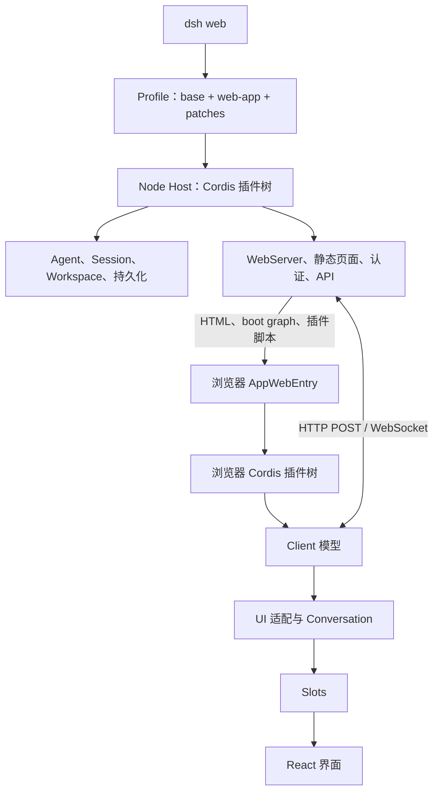
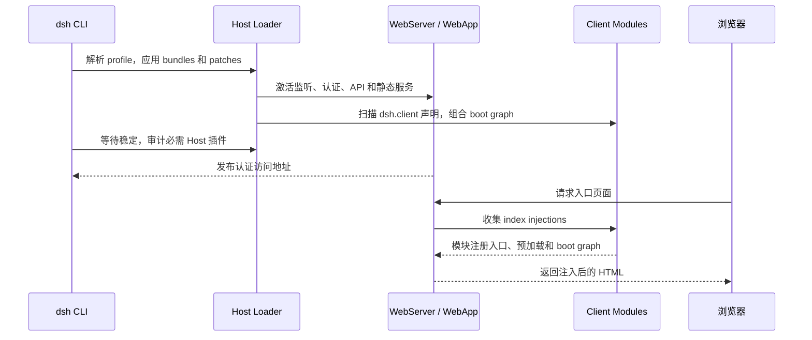
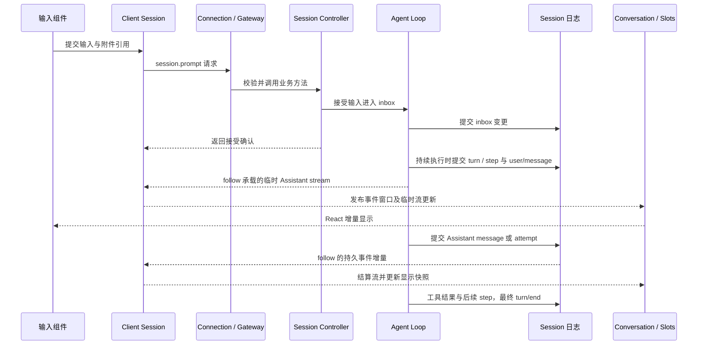
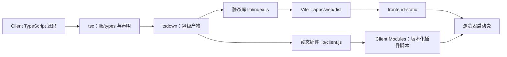

# apps/web 技术架构

## 概览

阅读本文可以从 `apps/web` 入口追踪到应用启动、插件加载、用户消息提交、会话恢复和最终界面渲染，并按问题找到负责的代码。本文是 Web 专题参考；项目级目录和 Agent 主循环见[项目架构](project-architecture.md)，框架与依赖总览见[技术架构](technical-architecture.md)。

Web 产品由 Node Host 和浏览器 Client 两个 Cordis 应用协作完成。Host 持有权威业务状态、执行 Agent、管理持久化和访问控制；Client 维护可观察的数据镜像与界面状态，并通过插件组合 React 界面。`apps/web` 负责浏览器入口、Vite 构建、公共资源和浏览器测试，完整实现分布在 `packages/bundle`、`packages/host`、`packages/api` 和 `packages/client`。

本文依据当前仓库源码和包级说明整理，适合已经了解 TypeScript、React 和基本客户端／服务端通信的开发者。首次接触 Cordis 时，可先阅读 [Cordis primer](../docs/cordis-primer.zh.md)。具体配置、方法和 wire 字段以链接到的源码及所属文档为准。

## 目录

- [整体结构与技术栈](#整体结构与技术栈)
- [目录与职责](#目录与职责)
- [Host 启动与配置装配](#host-启动与配置装配)
- [浏览器启动与插件加载](#浏览器启动与插件加载)
- [通信与 API](#通信与-api)
- [Client 模型与状态管理](#client-模型与状态管理)
- [Conversation 与 UI 装配](#conversation-与-ui-装配)
- [一条用户消息的完整链路](#一条用户消息的完整链路)
- [分页、刷新与断线恢复](#分页刷新与断线恢复)
- [认证、授权与部署](#认证授权与部署)
- [构建、开发与热更新](#构建开发与热更新)
- [Web、Desktop 与 Worker preview](#webdesktop-与-worker-preview)
- [测试与排查入口](#测试与排查入口)
- [架构取舍与扩展定位](#架构取舍与扩展定位)
- [延伸阅读](#延伸阅读)
- [维护备注](#维护备注)

-----

## 整体结构与技术栈

Web 有三个相互配合的组合系统：profile 装配 Host 插件，客户端模块系统交付浏览器代码，浏览器 Cordis 与 Slots 装配服务和界面。把这三者分别看清楚，才能区分配置、代码交付、运行时激活和视图渲染的问题。

主要技术的作用如下，具体版本由 [Web 包清单](../apps/web/package.json)及各包清单维护。

| 技术 | 在 Web 中的作用 |
|---|---|
| TypeScript、ESM、pnpm workspace | 组织跨包类型、构建程序和依赖关系。 |
| Node.js、Cordis | 承载 Host 插件服务、事件和可清理的注册；Cordis 也在浏览器内运行。 |
| React 18、React DOM | 绘制组件、管理组件局部交互，由 renderer 统一接入业务快照。 |
| Vite 6、tsdown、TypeScript compiler | 分别构建页面壳、包级运行时代码以及类型与中间产物。 |
| Typert Remote、API Gateway | 从 Host 服务生成 Remote 描述、编解码和 Client 声明，连接两侧调用。 |
| HTTP Fetch、WebSocket、SSE | 分别承载普通请求、业务逻辑流和插件变更通知。 |
| Zustand vanilla、Immer | 支持浏览器 UI snapshot store 和可选的本地持久化。 |
| micromark/mdast、Shiki、KaTeX | 支持 Markdown、代码高亮和数学公式显示。 |
| Vitest、Playwright | 覆盖模型逻辑、组件、完整装配和真实浏览器场景。 |

## 目录与职责

定位 Web 功能时，先判断问题属于应用组合、Host 业务、Client 模型还是呈现。下表只列主要入口，完整包索引由各包组 README 维护。

| 位置 | 主要职责 | 首要入口 |
|---|---|---|
| `apps/web` | HTML、浏览器入口、Vite 配置、图标和浏览器测试 | [main.ts](../apps/web/src/main.ts)、[vite.config.ts](../apps/web/vite.config.ts) |
| `apps/cli` | 启动所选 profile、管理配置与插件安装 | [CLI README](../apps/cli/README.zh.md) |
| `packages/bundle/web-app` | Web 产品的 Host／Client 插件组合、启动参数和页面服务装配 | [cordis.patch.yml](../packages/bundle/web-app/cordis.patch.yml)、[src/index.ts](../packages/bundle/web-app/src/index.ts) |
| `packages/host/webserver` | HTTP(S) 路由、upgrade、认证入口和 index injection 承载 | [src/index.ts](../packages/host/webserver/src/index.ts) |
| `packages/host/frontend-static` | 提供 Vite 产物与注入后的入口 HTML | [src/index.ts](../packages/host/frontend-static/src/index.ts) |
| `packages/client/web` | 浏览器启动内核、静态模块表、启动页及 renderer 交接 | [boot.ts](../packages/client/web/src/boot.ts) |
| `packages/client/modules` | Host 侧发现并发布插件图；Client 侧加载、物化和替换模块 | [README](../packages/client/modules/README.zh.md) |
| `packages/client/connection` | 请求地址、物理承载、连接代次、来源检查与载体适配 | [README](../packages/client/connection/README.zh.md) |
| `packages/api` | Remote 分发、各业务 Controller 及其配对 Client 模型 | [包组说明](../packages/api/README.zh.md) |
| `packages/client/ui-*` | UI 数据适配、Conversation、Slots、组件、布局和功能界面 | [包组说明](../packages/client/README.zh.md) |

有些包同时发布 Host 和 Client 两个入口。Host Loader 加载包根入口；浏览器模块系统加载 `./client` 导出的构建产物。双入口让一项功能能在同一包中维护两端协作，但两端的依赖和编译程序仍各自独立。

## Host 启动与配置装配

Web 的受支持 Node 启动路径是 `dsh` 的 `web` profile。默认组合在 `dsh-base` 上叠加 `dsh-web-app`：前者提供 Agent、模型、工具、Session 和存储等共有能力，后者加入 WebServer、认证、业务 Controller 和浏览器插件名单。详见[应用启动架构](../docs/architecture.zh.md#应用启动)。

### 配置层次

Profile 从空插件行列表开始，依次应用以下配置层。较后的 patch 可以覆盖前面的行。

1. Profile 声明的有序 bundles；默认 Web 为 `dsh-base`，再到 `dsh-web-app`。
2. Profile 自身的 `cordis.patch.yml`。
3. Harness home 的 `cordis.patch.yml`。
4. 命令行按传入顺序给出的 `--patch` overlays。

按行 id 更新配置时，patch 替换整行的 `config`，不会逐字段深度合并。分析某个部署的实际插件树，应以该 profile 的合成配置为准；只读默认 bundle 无法得知用户追加的插件或覆盖值。[配置组合实现](../packages/boot/app-boot/src/profile-context.ts)和 [Web bundle 说明](../packages/bundle/web-app/README.zh.md)维护具体语义。

### 服务装配和 ready

`web-startup` 将本次调用解析成普通的 `webStartup` 服务。依赖启动参数的行显式注入该服务，再读取监听地址、端口、TLS 或公开访问地址。默认 Web bundle 配置为 `127.0.0.1:3080`，调用参数和后续配置层可以改变部署值；它们不是前端常量。

WebServer 负责监听与路由；`web-app` 负责定位 frontend 包的 `dist`、安装静态处理器、发布访问地址，以及在 Loader 稳定和必需 Host 插件审计后公告 ready。监听端口已绑定、Host 已 ready、浏览器插件已激活和用户界面已渲染是不同的观察点。

静态处理器注册在唯一 fallback 位置，路由优先级为 exact、最长 prefix，最后才是 fallback。`/` 和 `/index.html` 返回注入后的入口；其他路径按资源处理，找不到时返回 404。因此这里不能假定所有未知 URL 都会回到 SPA 入口。缺失的构建产物也没有读取源码的兜底。[静态服务实现](../packages/host/frontend-static/src/index.ts)。

## 浏览器启动与插件加载

`apps/web/src/main.ts` 创建 `AppWebEntry`，其启动过程在 `client/web` 内完成。入口需要 Host 提供的模块注册入口和有效 boot graph；只有 Vite 输出文件不足以启动正式 Web 产品。

### 从 HTML 到 React

浏览器启动依次完成这些阶段：[boot.ts](../packages/client/web/src/boot.ts)等待注入完成，创建模块系统，预取标记为 `immediately` 的模块，然后创建 Cordis Context；[boot-client.ts](../packages/client/web/src/boot-client.ts)安装 Loader、创建清单内的插件、等待激活并审计；最后 [mount.ts](../packages/client/web/src/mount.ts)将挂载点交给动态加载的 UI renderer。

必需插件名单内已出现的插件若未激活，启动失败会留在启动页中；其他未激活插件产生警告，已有插件可以继续运行。缺少服务的插件可能处于等待状态，因此“脚本下载成功”不足以证明功能已经激活。浏览器 E2E 对完整产品组合采用更严格的要求，将这类启动警告也视为失败。

启动页在 React 之前由框架无关的 DOM 绘制。Renderer 使用 `hydrateRoot` 接管这段已有 DOM，再切换到应用组件；这段 hydrate 用来保持启动页交接连续，应用内容仍由浏览器渲染。[renderer.ts](../packages/client/ui-renderer/src/client/renderer.ts)。

### 两套依赖图

模块依赖与服务依赖分别决定“代码能否执行”和“插件能否激活”。两者使用不同的生命周期，排查加载问题时需要分别检查。

| 机制 | 解决的问题 | 主要依据 |
|---|---|---|
| 客户端模块图 | factory 到达、同步 `require`、缓存、共享模块身份与版本替换 | boot graph、`dsh.client`、`external` 和静态模块表 |
| Cordis 服务依赖图 | 某插件需要的服务是否存在，以及服务变化时的激活与清理 | 插件运行时 `inject` 和 Cordis fiber |

Host 扫描活动 Loader 条目中声明 `dsh.client` 的包，读取其 `./client` 产物，并形成 `WebBootGraph`。插件脚本通过 `/plugins` 下版本化 combo URL 交付；载入脚本先注册 factory，实际请求模块时才执行 factory。初始请求按 bootstrap／application 阶段组织，bootstrap 脚本先于 Vite 入口执行。

`React`、`React DOM`、Cordis 和若干基础库由壳提供共享实例，避免重复 React 破坏 hooks 与元素身份。普通功能插件经模块系统在运行时交付，不进入页面壳的 Vite 依赖图。[共享模块表](../packages/client/web/src/platform.ts)与 [Client Modules](../docs/subsystems/client-modules.zh.md)维护加载协议。

## 通信与 API

通信层把物理载体、类型化调用和业务行为分开。Connection 处理地址、请求关联、来源检查、载体选择和连接代次；Gateway 处理 Remote 分发、编解码、取消和逻辑流；业务 Controller 决定数据读写与业务结果。

### 网络通道与用途

| 通道 | 用途 | 所有者 |
|---|---|---|
| HTTP POST Remote | 查询、创建 Session、提交消息、修改设置等普通调用 | Connection 承载，Gateway 分发 |
| `/api/remote.mux` WebSocket | 多路业务逻辑流、流的 uplink 和控制帧 | API Gateway |
| `/plugins/events` SSE | 插件 graph 和 rebuilt 通知 | Client HMR |
| 精确 Fetch 路由 | 原始文件上传、下载等有独立 HTTP 响应的功能 | Connection 注册表与功能包 |

业务流与插件热更新各自恢复、各自管理状态。看到 `EventSource` 时应先确认它属于哪一项功能；当前 Session Remote 流由 WebSocket mux 承载。权威实现见 [Gateway](../packages/api/gateway/src/index.ts)、[Connection](../packages/client/connection/README.zh.md)和 [Client HMR](../packages/client/hmr/src/client/index.ts)。

### 类型化 Remote

Host 服务用 Typert Remote 标记可调用方法。生成流水线产出严格描述、运行时 codecs、声明合并和映射信息；`api-remotes` 在 Client 装配为 `ctx.remote.<namespace>`，Session scope 可以获得对应的 scoped Remote。功能包依赖生成的服务声明，无须把 Gateway 的实现放进组件。

参数或返回值中的错误由定义它的层处理：Connection 处理网络请求与身份，Gateway 校验调用协议并分发，Controller 判断业务条件。取消信号沿调用或逻辑流传递；停止一个逻辑流不等于关闭共用的物理 WebSocket。详细生成与调用语义见 [API Gateway](../docs/api-gateway.zh.md)。

内部 `$events` 是独立的逻辑流，负责选定 Cordis 事件的转发以及回答型 Client 的连接代次就绪。Host 先安装增量监听器，再发送 `ready`；Client 收到后才发布可用 generation，避免模型开始 baseline 查询时尚未建立观察。普通通知不自动成为持久历史；有状态领域仍需自己的 baseline 或日志游标。

## Client 模型与状态管理

客户端状态按权威来源和使用范围区分。业务模型维护 Host 状态镜像，UI store 维护浏览器交互，组件局部状态处理组件自己的短期行为。Host 仍负责持久业务结果；本地镜像决定如何把 baseline、增量和延迟返回合成可用快照。

### Session 和 Workspace 模型

Session 模型由配对的 `api/session-controller` Client 入口提供，主要层次是 `ClientSessions → SessionManager → Session`。`ClientSessions` 管理引用与 Session scope，`SessionManager` 管理目录、控制流、投影和对象身份，每个 `Session` 管理自己的连续事件窗口、分页、follow、提交与控制状态。模型本身不依赖 React。

Workspace 的配对 Client 模型管理 Workspace 行、排序、归档和固定 Session 集合，也负责异步命令返回与较新流更新之间的冲突顺序。重连时模型从完整 baseline 替换状态，UI 不需要在每个组件中复制这套恢复规则。详见 [Session Controller](../packages/api/session-controller/README.zh.md)与 [Workspace Controller](../packages/api/workspace-controller/README.zh.md)。

### UI 状态与导航

`client/store` 在 Zustand vanilla 与 Immer 上提供 snapshot store、通知和可选的 localStorage 持久化。草稿、当前选择和布局等 UI 状态可以使用这些 store；组件私有状态仍可由 React 本地状态维护。[store 实现](../packages/client/store/src/index.ts)。

当前主视图选择由 `ui-workspace` 的导航服务维护，并持久化到 `dsh.sessions.current`。打开新目标时，服务先 retain 新 Session 引用、更新 selection，再释放旧引用；全局中央面板则由 `ui-layout` 的 `activePanelId` 管理。因此理解当前会话切换应从服务状态和引用生命周期入手。[navigation.ts](../packages/client/ui-workspace/src/client/navigation.ts)、[layout service](../packages/client/ui-layout/src/client/service.ts)。

SessionProvider 可以绑定明确的 SessionReference，也可继承外层 binding。多个子树因而能够同时显示不同 Session；全局只有一个可读的“当前 Session”会限制这种组合能力，功能组件应消费自己的 scope 数据。

## Conversation 与 UI 装配

Conversation 负责将 Session 事件窗口转成显示模型，Slots 负责把模型和功能组件组合成界面，renderer 负责绑定 React。这三个职责分别支持事件解释、插件扩展和框架渲染。

### 从事件窗口到显示快照

`ui-conversation` 为每个 SessionBinding 的 eventSource 建立订阅，关联持久事件和 Client 临时 `assistant/live-chunk`，形成身份稳定的业务 Context，再由注册的 target builder 生成视图快照。窗口替换、向前分页、尾部追加和流结算各有对应更新路径。[装配实现](../packages/client/ui-conversation/src/client/conversation/assembly.ts)。

Chat 与 Trajectory 分别维护自己的 Definition、builder 和最终显示数据。它们可以解释相同事件族，但各自决定展示结构；共享的是 Session 输入与 Conversation 机制。新增事件时，需要检查哪些 target 应解释它，而不能只更新其中一个界面。[Conversation 参考](../docs/subsystems/conversation.zh.md)。

### Slots 和 React

`ui-session` 等适配包将模型 observable 转成标准数据源。`ui-renderer` 再通过 `useSyncExternalStore` 生成 hooks，管理 React Context 和根挂载。整个应用从唯一的 context 级 `renderSlot('root')` 展开，子 Slot 由组件获得的渲染接口继续组合。[hook 绑定](../packages/client/ui-renderer/src/client/bind.ts)、[根组件装配](../packages/client/ui-renderer/src/client/app.tsx)。

Slot 定义指定组件需要的 owner props、hooks、store、服务注入和子 Slot。呈现组件接收明确的输入与操作，不直接获取 Cordis Context 或连接对象。跨功能插件的业务协作走注入服务，跨功能界面组合走 Slots；共享的静态控件和工具有专门基础库。

插件注册还要考虑声明生命周期。`slots.inject` 等待真实 Slot 声明，在声明消失时清理贡献，并在重新声明后恢复注册；单纯等某个业务服务出现，不能证明目标 Slot 已经声明。完整规则见 [Slots](../docs/subsystems/slots.zh.md)与 [Client 开发约定](../packages/client/AGENTS.md)。

## 一条用户消息的完整链路

提交消息同时涉及命令接受和异步执行。Remote 返回“已接受”时，模型可能尚未完成；聊天界面的后续变化来自事件和控制流。

接受确认表示输入已经进入 inbox，不代表它已进入模型请求；Agent 后续接纳输入时才提交相应的 `user/message`。Host Controller 将 RPC 关联信息带入输入来源，以便客户端关联提交与后续观察。上图展示正常提交路径，HTTP 返回和异步流在浏览器中的到达次序不构成保证。

Agent Loop 的模型调用、工具执行和持久提交细节由[整体架构](../docs/architecture.zh.md#轮次流程)维护；Web 层主要负责把输入送达及把结果持续投影回来。

Assistant 临时 chunk 用于低延迟显示。结算后的 `assistant/message` 或 `assistant/attempt` 保存完整的紧凑流，其中 attempt 保留失败、取消等尝试而不增加模型历史。临时 chunk 本身不是独立的持久 token 行；进程在结算前丢失，不能从尚未提交的数据恢复完整尝试。

## 分页、刷新与断线恢复

恢复依赖每类数据自己的语义。持久日志靠逻辑序号和窗口，控制状态靠完整 baseline，普通通知则不自动回放。

### Session follow 与 page

Session `follow()` 的首帧包含 header、尾部历史、游标和投影 baseline，之后发送未被首帧覆盖的持久事件及可选临时 Assistant stream。Host 先注册监听，再获取 snapshot，通过 cursor 和临时流 ordinal 截断重复，从而覆盖 snapshot 获取期间发生的更新。[Host follow 实现](../packages/api/session-controller/src/web/controller.ts)。

Client 保留一个连续逻辑事件窗口。每次物理连接代次恢复时，新 follow snapshot 原子替换窗口；标准事件随后按序追加。`page()` 负责更早历史及序号缺口修复，逻辑序号范围由 journal 校验。已结算的紧凑 Assistant stream 与实时流最终进入同一目标装配，因此刷新和向前翻页可以重建相同类型的显示状态。

### 不同状态的恢复策略

| 状态 | 断开期间 | 恢复方式 |
|---|---|---|
| Session 持久事件窗口 | 已接收事件仍是可读历史 | follow 的新 snapshot 替换窗口，再接收增量；需要时 page |
| Session 控制与 Workspace | 可以保留最后发布的值 | 完整 opening baseline 替换上一代数据 |
| Assistant 未结算输出 | 依赖活跃 Host 的临时状态 | follow 首帧可带临时基线；已结算输出从日志重建 |
| 普通转发通知 | 不保证回放 | 功能若需恢复，必须另有查询、baseline 或游标 |
| 插件组成 | 页面保留当前已装配树 | HMR 通道提供当前 graph，并按协议协调替换 |

物理网络故障可以重试；领域流中未被分类为载体故障的业务或协议错误会终止所属流。`$events` 的 readiness 失败会使 Connection generation 失效并进入连接恢复，Assistant stream 的 revision 缺口也被显式归类为载体故障，以便重新打开 follow。错误是否重试由分类和所有者决定，不能只看它是否发生在解析阶段。[Client Session transport](../packages/api/session-controller/src/client/transport.ts)与 [Web Client 重连说明](../docs/subsystems/web-client.zh.md#重连)。

## 认证、授权与部署

WebServer 对匹配的路由和 upgrade 执行来源检查与对应认证策略，业务调用再接受权限检查。默认 token 交换由认证插件的预路由中间件处理。监听地址、公开访问地址和受信任 authority 分别控制不同的行为。

| 层次 | 回答的问题 | 实现所有者 |
|---|---|---|
| 来源检查 | 请求的 Host、Origin 和浏览器跨站信息是否允许 | Connection 的 [api-request-trust.ts](../packages/client/connection/src/api-request-trust.ts) |
| 身份认证 | 请求对应哪个已认证 Peer | [authentication-token](../packages/host/authentication-token/README.zh.md)及认证 provider |
| 调用授权 | 该 Peer 能否调用方法、读取资源或参与交互 | [RemoteAccess](../packages/api/remote-access/README.zh.md)和 Gateway |

默认认证插件提供带 token 的访问地址，入口请求交换成签名 Cookie 后跳转到干净路径。Cookie 的 authority、有效期和 TLS 属性由认证实现负责；后续 API 和 WebSocket 使用已认证 Peer。匿名静态资源仍接受来源检查，匿名不意味着跳过全部网络检查。

`--host` 决定监听的具体本地 IP，wildcard 地址被拒绝；`--public-url` 决定对外公告的应用根地址，不赋予来源信任；额外 authority 由 `--trusted-host` 等配置声明。TLS 证书和私钥需要成对提供。代理部署还涉及公开路径前缀、Cookie Path 和 WebSocket upgrade，完整要求集中在[公开部署指南](../docs/user/guide/public-deployments.md)。

## 构建、开发与热更新

Web 的开发循环消费真实构建产物。理解哪一层产物更新，能解释为什么源码已经改变而页面仍显示旧行为。

### 产物链路与两种代码交付

Vite 链接静态库并输出 HTML、主 chunk、资源和按需 chunk；客户端插件独立打包后，由 Host 的模块表交付。页面构建对 React／React DOM 做去重，将较稳定的 Markdown、数学与高亮依赖组织进 vendor chunk，并保留按需语法包。具体分包以 [vite.config.ts](../apps/web/vite.config.ts)为准，不在本文固定产物大小或哈希。

Client CSS 可以作为模块 metadata 随包交付，renderer 统一安装到主文档，卸载时按模块生命周期清理。第三方样式等静态输入另经 Vite 管线处理；不能把所有插件 CSS 都理解为页面入口直接 import 的全局文件。

### 开发循环和检查职责

根目录的 `dev:web` 脚本先构建产物，再协调 TypeScript、tsdown 和 Vite build watchers，并启动 `dsh web`。其中任一 watcher 退出都会结束开发循环，避免开发者一直使用停更的产物。裸 Vite serve 由配置主动拒绝，因为它缺少 Host 提供的注入清单。[开发脚本](../scripts/dev-web.ts)维护具体参数。

Host 和 Client 使用各自 TypeScript 编译面。两端可以为 Cordis `Context` 的同名服务声明不同实现，若混在同一个程序中会发生声明冲突；浏览器 E2E 虽然操作页面，测试文件仍属于 Host 编译面。源码检查和消费构建产物的检查也有不同依赖。[TypeScript project layout](../docs/development.zh.md#typescript-project-layout)维护构建与检查流程。

### 插件热更新

Client HMR 监听 Host 的插件图变化，并轮询已发布插件产物的文件信息。变化后 Host 发布 graph 或 rebuilt 帧；浏览器通过 `/plugins/events` 接收，再交给模块条目控制器串行执行 sync／reload。插件自身的注册、事件和样式都需要具备可逆的生命周期，更新才能完整释放旧实现。

这里的热更新处理模块和 Cordis 插件生命周期；不能假定替换后保留所有 React 局部状态。Host release 改变时，页面不会直接跨 release 应用新图，而是等待整页重载；同一 release 内的图和版本替换由模块系统协调。[HMR README](../packages/client/hmr/README.zh.md)与 [Client Modules README](../packages/client/modules/README.zh.md)。

## Web、Desktop 与 Worker preview

三个载体共享浏览器应用的核心路径，但 Host 位置和启动注入方式不同。判断一项行为属于哪一层，应先确认实际载体。

| 载体 | Host 和页面 | 注入／通信特点 |
|---|---|---|
| Web | `dsh web` 启动 Node Host；Host 提供页面 | HTML 注入 boot graph，经 HTTP 和 WebSocket 连接 |
| Desktop | Electron 启动 Desktop Host；页面可先从打包资源加载 | `dshDesktopBoot` 等待 Host ready，应用 injections 并提供 transport 信息 |
| Worker preview | 独立 preview bootstrap 在浏览器 Worker 中连接实验运行时 | 先选择和连接 Worker Host，再复用后续页面启动链 |

Desktop 的主要 UI 仍由相同 Client 插件提供，Electron carrier 处理本地 Host 认证和引导；仅凭 `streamBaseUrl` 不会获得访问权限。[入口分支](../apps/web/src/main.ts)和 [Desktop 架构](../apps/desktop/README.zh.md)描述其交接。

Worker preview 有单独 bootstrap 和构建分区，默认发布的 Web 包排除 preview 页面和目录；产品构建还有实验输入隔离检查。`manifest.webmanifest` 与应用图标提供安装展示元数据，不能据此推断完整离线产品能力。Worker preview 的能力与限制由其[实验运行时](../packages/experimental/webworker-runtime/README.md)维护。

## 测试与排查入口

测试按职责验证数据语义、呈现和完整装配。选择场景时应匹配受影响的数据路径，避免用组件测试代替连接恢复，或仅凭 Host 方法结果推断浏览器显示。

### 验证层次

| 层次 | 验证目标 | 所属位置 |
|---|---|---|
| 模型与协议测试 | baseline、增量、并发返回、流错误、清理和状态转换 | 各 API／Client 包 tests |
| React 组件测试 | 给定 props、hooks 和 store 时的可见行为 | 对应功能包的组件 specs |
| 完整 Client 装配 | 真实启动壳与插件组合能否激活和呈现 | [assembled-boot.ts](../apps/web/tests/assembled-boot.ts) |
| 浏览器 E2E | 真实 Host、HTTP、WebSocket、Client 和浏览器交互 | [apps/web/tests](../apps/web/tests/README.zh.md) |

浏览器 scaffold 使用正式 base／web-app 组合，并通过测试 patch 替换持久化目录等环境。默认 keyless replay 从记录提供模型行为，record 使用真实 provider 采集记录，refresh 用 replay 更新期望输出。大部分场景运行 Chromium，指定恢复和交互场景也使用 WebKit；具体覆盖以[测试说明](../apps/web/tests/README.zh.md)和 [scaffold](../apps/web/tests/scaffold.ts)为准。

### 按症状找所有者

| 症状 | 优先检查 | 相关证据或场景 |
|---|---|---|
| 页面资源 404 | frontend dist 是否存在、frontend-static 路径与 mount | [frontend-static](../packages/host/frontend-static/src/index.ts) |
| 启动页显示插件 pending／failed | boot graph、模块下载、Cordis 缺失服务与必需名单 | [boot-client](../packages/client/web/src/boot-client.ts)、[built boot](../apps/web/tests/built-boot.expected.e2e.ts) |
| 源码改变但功能未变 | 对应的 tsc、tsdown、Vite watcher 与所消费产物 | [dev-web](../scripts/dev-web.ts) |
| 请求 401／403 | 分别确认身份 Cookie、来源检查和方法授权 | [Connection](../packages/client/connection/README.zh.md)、[RemoteAccess](../packages/api/remote-access/README.zh.md) |
| 发送已接受但回答未显示 | Session 控制状态、follow、模型窗口及 target 装配 | [Session Controller](../packages/api/session-controller/README.zh.md)、[Conversation assembly](../packages/client/ui-conversation/src/client/conversation/assembly.ts) |
| 刷新或重连后内容异常 | follow 首帧、逻辑序号范围、generation 替换与流结算 | [connection recovery](../apps/web/tests/connection-recovery.e2e.ts)、[replay reload](../apps/web/tests/session-replay-reload.e2e.ts) |
| 动态启停后残留界面／样式 | effect disposer、Slot 声明寿命、模块 metadata 清理 | [plugin live](../apps/web/tests/client-plugin-live.e2e.ts)、[DocumentStyles](../packages/client/ui-renderer/src/client/styles/document-styles.ts) |

## 架构取舍与扩展定位

这套结构支持按配置替换能力，并复用 Web／Desktop 的界面实现。代价主要是跨包阅读、生成与构建链路，以及运行时依赖和清理行为的协调。

| 设计 | 带来的能力 | 需要承担的成本 |
|---|---|---|
| 两端 Cordis 插件化 | 同一组合方式覆盖模型、工具、Host 服务和 UI | 功能正确还依赖配置装配、服务注入与卸载顺序 |
| 动态插件图与静态壳分离 | 插件名单可变，壳和共享依赖保持统一身份 | 增加版本化 bundle、预加载、依赖到达与替换协议 |
| React-free Client 模型 | 恢复、分页和状态竞争可独立测试，并服务多个 UI 子树 | 需要明确模型、UI adapter 与组件各自的状态所有权 |
| Conversation 多 target | Chat、Trajectory 可按不同显示需求演进 | 新事件可能需要分别补齐多个 target 的解释 |
| 日志与临时流分工 | 实时反馈和可重建历史各有明确输入 | 必须处理 snapshot 截断、重复、序号范围与结算 |
| Slots 组合 UI | 插件可贡献界面，无须相互运行时导入 | 需要类型化声明和完整生命周期，组件树不再集中在单个 App 文件 |

扩展时，应选择最靠近行为所有者的位置。新增查询或业务命令放在领域服务与配对 Controller；新界面操作消费 Client 服务并贡献 Slot；新的聊天展示从 Conversation target 入手；只有通信载体或调用协议变化才进入 Connection／Gateway。共享控件先检查 [ui-primitives](../packages/client/ui-primitives/README.zh.md)，不要把另一功能插件的实现直接当公共组件库。

新增浏览器插件还涉及三项装配：包声明 `dsh.client` 和 `./client` 导出，Client TypeScript aggregate 引用，以及 Web bundle 的配置行和解析依赖。源码目录存在并不意味着插件自动进入产品。完整开发要求以 [Client AGENTS](../packages/client/AGENTS.md)及[添加包指南](../docs/cookbook/adding-a-package.zh.md)为准。

## 延伸阅读

以下资料分别维护总体机制和更细的包级行为，本文作为它们之间的阅读导航。

- [Web Client 架构](../docs/subsystems/web-client.zh.md)：两端所有权、Client 模型、数据通路和重连语义。
- [Client Modules](../docs/subsystems/client-modules.zh.md)：boot graph、包发现、combo 脚本和模块服务。
- [API Gateway](../docs/api-gateway.zh.md)：Remote 生成、运行时调用和职责。
- [WebServer](../docs/subsystems/web-server.zh.md)：路由、upgrade 和 index injection。
- [Slots](../docs/subsystems/slots.zh.md)：组件输入、声明、scope、渲染与生命周期。
- [Conversation](../docs/subsystems/conversation.zh.md)：业务 Context、target、事件关联和窗口更新。
- [公开部署指南](../docs/user/guide/public-deployments.md)：监听、反向代理、认证地址及 Cookie 配置。
- [开发指南](../docs/development.zh.md)：开发命令、编译面和产物布局。
- [测试指南](../docs/testing.zh.md)：验证层次、snapshot 和相关检查的选择。

-----

## 维护备注

非权威的临时维护记录

无。

